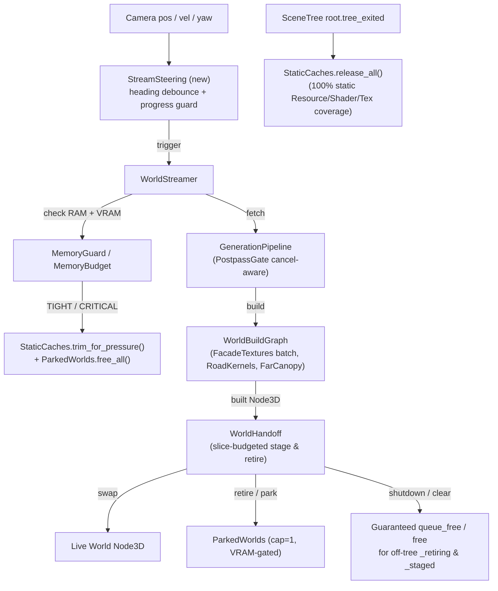

# Streaming Memory, Frame-Pacing, Build Hotspots & Weather Polish Plan

> **Scope:** Four prioritized engineering & visual-polish workstreams surfaced by the live roaming telemetry in [`25.11.2026_debug.txt`](25.11.2026_debug.txt) and the weather-dressing visual captures ([`PLAN-weather-driven-dressing.md`](PLAN-weather-driven-dressing.md)):
> 1. **Workstream 1 — Streaming Memory Growth & Exit Leaks** (18.2 GB footprint / 9.5 GB VRAM / 21,515 leaked `ObjectDB` instances / 226 leaked `Texture` RIDs).
> 2. **Workstream 2 — Streaming Thrash & 80–143 ms Frame Hitches** (15+ consecutive dropped generations, `worst frame fetch 143.0 ms, build 80.6 ms`, `PostpassGate` 14.0 s contention).
> 3. **Workstream 3 — Build-Time Hotspots & Orthophoto Fallback** (`facade_compose` 4.06 s, `Roads` 4.58 s, `FAR-CANOPY` 3.05 s, `Orthophoto: part 2 unreadable or blank`).
> 4. **Workstream 4 — Weather-Dressing Visual Polish** (2.4 km elevated-lookout fog seam, heated-shopfront corner frost, blowing-snow ground drift at `wind_kmh > 25`, optional weather-chip live telemetry tooltip).
>
> **Integration with existing plans:** Builds directly on Phase 1 of [`PLAN_Ultra_speedup.md`](PLAN_Ultra_speedup.md) (commit `91eb6686`: `BuildPrewarm`, `PbrTextures` path dedup, governor sub-steps, `LodSpread`, `AtmosphereRig` diffs) without duplicating any completed item, and aligns Workstream 3's road kernel with `PLAN_Ultra_speedup.md` P3.3.

---

## 0. Evidence Summary & Class-Size Budget

### 0.1 Telemetry Evidence (`25.11.2026_debug.txt`)

| Metric / Event | Observed Value | Log Reference | Target After Fix |
|---|---|---|---|
| Peak process footprint (roaming) | **18,237 MB** (settles 17,020 MB) | `25.11.2026_debug.txt` (MEM lines) | **≤ 6,500 MB** steady-state Ultra roaming |
| Peak video memory (VRAM) | **9,517 MB** (settles 9,273 MB) | `25.11.2026_debug.txt` (MEM lines) | **≤ 4,000 MB** steady-state Ultra roaming |
| Live `ObjectDB` objects (roaming) | **69,398** peak / **56,014** settled | `25.11.2026_debug.txt` | **≤ 28,000** steady-state |
| Exit `ObjectDB` leak count | **21,515 instances** + 8 resources | `25.11.2026_debug.txt` L907–915 | **0** leaked instances / resources |
| Exit `Texture` RID leaks | **226 RIDs** (135 `RendererRD`) | `25.11.2026_debug.txt` L907–915 | **0** leaked RIDs |
| Consecutive dropped stream builds | **15+ drops** (`gen 9..46`) | `STREAM drop gen ...` | **≤ 1** drop per genuine U-turn |
| Worst main-thread frame hitch | **143.0 ms** (fetch), **80.6 ms** (build) | `25.11.2026_debug.txt` L864 | **≤ 25 ms** p99 during fetch/build |
| `PostpassGate` slot contention | held **14.0 s**, longest wait **12.4 s** | `25.11.2026_debug.txt` L864 | Cancelled builds release slot ≤ 0.5 s |
| `facade_compose` time | **4,061 ms** (of 7,572 ms `mapped`) | `25.11.2026_debug.txt` L860 | **≤ 1,200 ms** cold / **≤ 150 ms** warm |
| `Roads` build time | **4,581 ms** (`rails: 615 ms`) | `25.11.2026_debug.txt` L844 | **≤ 2,000 ms** |
| `FAR-CANOPY` build time | **3,047 ms** (54,762 crowns / 16 meshes) | `25.11.2026_debug.txt` L847 | **≤ 900 ms** |
| Inner orthophoto fallback | `part 2 unreadable or blank` | `25.11.2026_debug.txt` L804 | Retry transient WMS errors; keep valid parts |

### 0.2 Class-Size Budget (`AGENTS.md`: ≤ 1000 lines per GDScript file under `scripts/`)

Several files implicated by these 4 workstreams are at or within 18 lines of the hard 1000-line gate. **No new logic may be added inline to the red-zone files**; extract focused helper classes instead and run `tools/check_class_size.sh` at every milestone.

| File | Current Lines | Headroom | Strategy |
|---|---:|---:|---|
| `scripts/screens/view_360.gd` | **999** | **1** | **Freeze.** Zero inline additions; delegate to `ViewChrome`, `WorldStreamer`, `MemoryGuard`. |
| `scripts/generation/road_builder.gd` | **998** | **2** | **Freeze / shrink.** Extract road-mesh / intersection sub-stage into `RoadMeshPass` (or native `RoadKernels` wrapper). |
| `scripts/render/world_streamer.gd` | **982** | **18** | **Extract.** Move steering/debounce/abort-guard policy into a new `StreamSteering` helper class (`≤ 200` lines). |
| `scripts/screens/view_chrome.gd` | 861 | 139 | Safe for tooltip helper (~30 lines). |
| `scripts/generation/ground_shader.gd` | 551 | 449 | Safe (~15 lines via `// @FOG` injection). |
| `scripts/generation/facade_composer.gd` | 551 | 449 | Safe; move pixel loops to native/Image ops. |
| `scripts/generation/far_surface.gd` | 531 | 469 | Safe; replace inline fog block with `// @FOG`. |
| `scripts/generation/storey_composer.gd` | 469 | 531 | Safe (no or minimal change). |
| `scripts/generation/facade_textures.gd` | 445 | 555 | Safe (~40 lines for canonical key + batch prewarm). |
| `scripts/render/precipitation.gd` | 414 | 586 | Safe (~75 lines for wind-driven snow spindrift). |
| `scripts/generation/far_canopy.gd` | 309 | 691 | Safe (~50 lines for `mm.buffer` / native handoff). |
| `scripts/data/ortho_fetcher.gd` | 294 | 706 | Safe (~45 lines for per-part retry + diagnostics). |
| `scripts/render/world_handoff.gd` | 245 | 755 | Safe (~35 lines for leak-proof `clear()` + budget). |
| `scripts/render/memory_budget.gd` | 156 | 844 | Safe (~30 lines for VRAM ceiling + absolute cap). |
| `scripts/render/static_caches.gd` | 140 | 860 | Safe (~45 lines for missing caches + `trim_for_pressure()`). |
| `scripts/render/memory_guard.gd` | 112 | 888 | Safe (~25 lines to trigger `StaticCaches.trim_for_pressure()`). |
| `scripts/render/parked_worlds.gd` | 67 | 933 | Safe (~15 lines for leak-proof `forget()` / `free_all()`). |

---

## 1. Architecture Overview (Streaming Lifecycle & Memory Ownership)



---

## 2. Workstream 1 — Streaming Memory Growth & Exit Leaks

### 2.1 Root Causes Identified

1. **Unfreed off-tree `Node3D`s on `WorldStreamer.shutdown()` / `WorldHandoff.clear()` (causes the 21,515 leaked `ObjectDB` instances & 226 `Texture` RIDs):**
   - `WorldHandoff._retiring` holds detached `Node3D` subtrees removed from the scene tree and awaiting sliced `free()`. In `WorldHandoff.clear()` (`scripts/render/world_handoff.gd:245`), `_retiring.clear()` drops array references **without freeing** nodes that are no longer inside the scene tree — leaking an entire 15k–25k-node world and all its `ArrayMesh`/`ShaderMaterial`/`ImageTexture` RIDs on exit.
   - `WorldStreamer.shutdown()` (`scripts/render/world_streamer.gd:561`) calls `_parked.forget()`, which clears `ParkedWorlds._entries` assuming the scene root will free them. Any parked world detached from the tree (or held in `_ready` before staging completes, or held by `StreamDetail` while staging) is leaked if not explicitly freed.
   - Dropped builds in `WorldStreamer._on_finished()` (`world_streamer.gd:940-964`) free `built[1]`, **but** if `v.build_location()` is aborted mid-flight or `StreamDetail` finishes after `invalidate()`, detached detail nodes or `GroundTruth` / `LocationData` images can remain referenced until shutdown.

2. **Missing entries in `StaticCaches.release_all()` (`scripts/render/static_caches.gd`):**
   - `StaticCaches.hook_exit(get_tree())` is wired in `scripts/main.gd:140`, yet several static `Shader` / `Texture2D` / `Material` / `Mesh` caches added later are omitted from `release_all()`, causing `RendererRD` texture and resource leaks on exit:
     - `FarSurface._shader` (`scripts/generation/far_surface.gd:454`)
     - `TreeMeshLibrary._bufs`, `_meshes`, `_mats` (and any leaf/impostor texture caches)
     - `FacadeLiteShader._shader`, `LandmarkShader._swapped`
     - `GroundShader` / `GroundMaterial` / `FarTerrainBuilder` static shaders & cached textures
     - `WeatherDressing` / `FogModel` / `SharedShader` static shader dictionary
     - `WaterShader` / `RoofSnow` / `StreamLog` / `BuildPrewarm` remembered buffers

3. **Unbounded roaming footprint (18.2 GB RAM / 9.5 GB VRAM) because `MemoryBudget` never trips `TIGHT` on high-RAM desktops:**
   - `MemoryBudget.usage()` computes `footprint / limit_bytes()`. On 64–128 GB Apple Silicon Macs, a percentage-only RAM limit allows the app to grow past 18 GB RAM and 9.5 GB VRAM without `MemoryGuard` ever entering `TIGHT`!
   - Consequently:
     - `ParkedWorlds` retains hidden full-Ultra worlds (~2.5–3.5 GB VRAM each).
     - `PbrTextures._raw_images` keeps decoded 2K uncompressed `Image` buffers in RAM permanently across streamed stretches.
     - `FacadeTextures._store` keeps up to `STORE_CAP = 256` composed texture sets across stretches.
     - `CityOpenData._decoded`, `HelsinkiLod2._decoded`, `TurkuLod2Meshes._decoded`, `CogFetcher._tiles`, `OsmParseCache`, and `MaterialLibrary._set_images` never evict between streamed centres.

### 2.2 Concrete Fixes

1. **Leak-proof teardown in `WorldHandoff`, `ParkedWorlds`, `StreamDetail`, and `WorldStreamer`:**
   - `WorldHandoff.clear()` (`scripts/render/world_handoff.gd`): iterate `_retiring` and `_staging` (and any held `_holder` not in tree); for every `is_instance_valid(n) and not n.is_inside_tree()`, call `n.free()`. Ensure `NOTIFICATION_PREDELETE` invokes the same cleanup.
   - `ParkedWorlds.forget()` (`scripts/render/parked_worlds.gd`): rename/split into `free_all()` (always frees every parked `world` via `free()` if not in tree, or `queue_free()` if in tree) and call `free_all()` from `WorldStreamer.shutdown()` instead of `forget()`.
   - `WorldStreamer.shutdown()`: explicitly free `_ready[1]` if valid and not in tree, cancel & free `_pipeline` and all `_retiring_pipes`, cancel `_detail` and free any pending detached detail subtrees, and call `_handoff.clear()`.

2. **Complete `StaticCaches.release_all()` + add `StaticCaches.trim_for_pressure(level: int)`:**
   - Audit every `static var` holding `Resource`, `Texture`, `Image`, `Mesh`, `Material`, `Shader`, or `Node` across `scripts/` (using an automated grep/test) and add all missing entries to `StaticCaches.release_all()` (including `SharedShader`, `FarSurface`, `TreeMeshLibrary`, `LandmarkShader`, `FacadeLiteShader`, `GroundMaterial`, etc.).
   - Add `StaticCaches.trim_for_pressure(level: int)`:
     - On `Level.TIGHT`: clear `PbrTextures._raw_images`, `FacadeComposer._wall_cache`, `StoreyComposer` scratch cache, `OsmParseCache`, and cap `FacadeTextures._store` to only current-world keys; evict `ParkedWorlds`.
     - On `Level.CRITICAL`: additionally clear `CityOpenData._decoded`, `HelsinkiLod2._decoded`, `TurkuLod2Meshes._decoded`, `CogFetcher._tiles`, `MaterialLibrary._set_images`, and unused `LandmarkMaterials._texs`.
   - Wire `MemoryGuard.level_changed` in `scripts/main.gd` (or `MemoryGuard._apply_level`) to call `StaticCaches.trim_for_pressure(next)`.

3. **VRAM-aware & absolute desktop ceiling in `MemoryBudget` (`scripts/render/memory_budget.gd`):**
   - Cap `MemoryBudget.limit_bytes()` on desktop to `min(ram_share_limit, 8 GiB)` (configurable via debug/env override) so `TIGHT` engages at ~5.6 GB, `CRITICAL` at ~6.4 GB, and `EMERGENCY` at ~7.2 GB even on 64–128 GB machines.
   - Add `MemoryBudget.vram_usage()` reading `RenderingServer.get_rendering_info(RenderingServer.RENDERING_INFO_VIDEO_MEM_USED)` against a desktop VRAM ceiling (e.g. `4.5 GiB` on Ultra, `3.0 GiB` on High), and have `MemoryBudget.usage()` return `maxf(ram_usage, vram_usage)`.
   - After every streamed swap (`WorldStreamer.apply_swap`), release CPU-side `Image` copies on `LocationData` that are no longer needed once GPU textures are uploaded (e.g., `far_drapes` raw images after `FarCanopy` / `SettlementMap` finish, keeping only lightweight metadata).

---

## 3. Workstream 2 — Streaming Thrash & 80–143 ms Frame Hitches

### 3.1 Root Causes Identified

1. **Hyper-sensitive drop conditions (`WorldStreamer` lines 316–354, 725–746):**
   - `heading_misses(pos, vel)` projects a straight ray from `pos` along instantaneous `_vel` to the live detailed square edge (`exit_missed`). Any gentle banking turn or orbit around a landmark while roaming in drone mode triggers `veered` (`camera heading off the ready stretch`) or `camera turned away mid-build`, dropping a build that already burned 10–19 s of CPU and network.
   - `swap_stale` (`world_streamer.gd:316`) drops a `READY` world immediately whenever `pos.length() < TRIGGER_M * 0.5 and vel.length() > TURN_BACK_MPS and vel.dot(pending_target_xz - pos) < 0.0` — zero hold timer! A 0.2 s reverse nudge discards a completed build.
   - No **progress-weighted abort protection**: a generation that has already finished `fetch` and is >60% into `build` is still aborted on a minor heading change, even though finishing it in 2–3 s and parking it is far cheaper than cancelling and restarting from scratch.
   - No **restart cooldown** after a drop: `invalidate()` → `_start_generation()` fires immediately on the same frame, causing the observed cascade (`gen 9, 13, 15, 17, 19, 22, 24, 26, 28, 30, 32, 34, 36, 44, 46`).

2. **Main-thread frame hitches (`fetch 143.0 ms`, `build 80.6 ms`):**
   - **Fetch-phase 143 ms spike:** `OrthoFetcher._stitched()` (`ortho_fetcher.gd:289`) calls `ImageTexture.create_from_image(mosaic)` on a 3584×3584 / 4096×4096 mipmapped image synchronously on the main thread; similarly `SatelliteFetcher` / `FarFieldFetcher` upload large textures in a single frame, and `GenerationPipeline` callback bursts (multiple fetchers completing in the same frame) decode/finalize back-to-back on the main thread.
   - **Build-phase 80.6 ms spike:** `WorldHandoff.pump()` and `StreamDetail` attach heavy `MultiMeshInstance3D` / `MeshInstance3D` batches (e.g., 54k-crown `FarCanopy` or `Buildings` chunk) whose first `add_child` / shader compilation / RID upload exceeds `WorldHandoff.BUDGET_US`, or `FacadeTextures` calls `ImageTexture.create_from_image()` synchronously on the main thread when pumping.
   - **`PostpassGate` 14.0 s slot hold / 12.4 s wait:** Cancelled `GenerationPipeline` instances and `StreamScout` warm-ahead fetches hold a `PostpassGate` concurrency slot until their HTTP timeout or response arrives, starving the newly-started active generation.

### 3.2 Concrete Fixes

1. **Extract `StreamSteering` (`scripts/render/stream_steering.gd`, new class, ≤ 180 lines) out of `WorldStreamer`:**
   - Keeps `world_streamer.gd` **under 950 lines** (currently 982/1000).
   - **Velocity/heading smoothing:** Compute a damped heading vector (`tau = 0.6 s`) for `heading_misses` / `swap_stale` instead of raw single-frame `_vel`.
   - **Hold timers & hysteresis:**
     - Require `swap_stale` to hold continuously for **`STALE_HOLD_S = 1.2 s`** (was 0 s) before dropping a `READY` world.
     - Increase `MISS_HOLD_S` (veer hold) to **`2.5 s`** when `state == State.FETCHING` and **`1.8 s`** when `state == State.READY`, plus require angular divergence `> 55°` from the vector to `pending_target_xz` (so gentle curves don't trip `exit_missed`).
   - **Progress-weighted abort guard:**
     - Once a generation enters the `BUILD` phase (`_fetched_msec > 0`), **do not cancel** on `veered` (only cancel on hard `should_redirect` when already past the live edge off both squares, or on season/preset/place change). Let the build finish (it's already on worker threads), then park it (if VRAM allows) or swap if the camera curved back.
   - **Drop cooldown:** After a heading-induced drop, enforce a **`DROP_COOLDOWN_S = 2.0 s`** settle window before launching a new generation (unless `near_edge` is true), letting the user finish turning before committing another 10 s fetch+build.
   - **Priority cancellation for `PostpassGate`:** When `GenerationPipeline.cancel()` runs, immediately abort active `HTTPRequest`s and release its `PostpassGate` slot (adding `PostpassGate.release_for(owner_id)`), and give foreground/active `WorldStreamer` requests priority over `StreamScout` background pre-fetches.

2. **Eliminate 80–143 ms main-thread frame spikes:**
   - **Staggered GPU texture upload queue (`TextureUploadQueue` or inside `WorldHandoff`):** Spread large `ImageTexture.create_from_image()` calls (>1 MP: orthophotos, satellite drapes, far drapes) to **at most 1 large texture upload per frame** during `WorldStreamer` background fetches/builds.
   - **Tighter `WorldHandoff` per-frame budget during streaming:** Check `Time.get_ticks_usec()` *before and after* every child attach/free in `WorldHandoff.pump()` (so a single heavy subtree that took 4 ms immediately ends the slice instead of attaching 3 more), and split `FarCanopy` / `Buildings` top-level attaches into smaller sibling chunks when staging.
   - **Cap `FrameTask` main-thread resume bursts:** Ensure at most one `GenerationPipeline` fetcher completion finalizes per frame when `background == true`.

---

## 4. Workstream 3 — Build-Time Hotspots & Orthophoto Fallback

### 4.1 Root Causes Identified

1. **`facade_compose` = 4,061 ms (half of the 7,572 ms `mapped` buildings time):**
   - **Unnormalized cache key in `FacadeTextures.composed()` (`facade_textures.gd:206`):** `var k := var_to_str(inputs)` serializes the entire `look: Dictionary`, including keys that `FacadeComposer.compose_tile()` does **not** use for pixel generation (e.g. `bay_m`, `floor_h`, `city` when not smooth-plaster, unrounded colour floats). Two buildings with identical tile pixels miss `_store` and re-compose from scratch.
   - **Pure GDScript per-pixel loops in `FacadeComposer` (`facade_composer.gd:218-221, 252-265`):**
     - `_soften(img, keep)` executes **two nested `for y / for x` `get_pixel`/`set_pixel` loops** over 512×128 = 65,536 pixels (131,072 GDScript pixel calls per call!), called twice per smooth-plaster tile (`alb` + `nor` in Helsinki/Stockholm/Espoo/Turku/Miami!) and on every `_wall_layer` cache miss.
     - `_wall_layer` tangent-frame rotation (`nor` when `turn == true`) also runs a GDScript `get_pixel`/`set_pixel` loop.
     - `FacadeComposer.compose_tile` runs **serially** inside `BuildingBuilder`'s mapped loop on one thread, even though `FacadeTextures.prewarm()` already proves `WorkerThreadPool.add_group_task` works safely for tile composition!

2. **`Roads` = 4,581 ms (`scripts/generation/road_builder.gd`, 998/1000 lines):**
   - `RoadBuilder` performs polyline offsetting, intersection filleting, ground-height sampling, kerb/paving/marking triangulation, and `SurfaceTool` / `ArrayMesh` assembly in GDScript on a single thread.
   - Because `road_builder.gd` is at **998/1000 lines**, optimization must extract a focused helper class (`RoadMeshPass`) and/or native GDExtension kernel (`RoadKernels`, aligning with `PLAN_Ultra_speedup.md` P3.3).

3. **`FAR-CANOPY` = 3,047 ms for 54,762 crowns in 16 meshes (`scripts/generation/far_canopy.gd`):**
   - Although `_probes_native()` runs in C++ (`CanopyKernels.probes`), lines 102–120 of `far_canopy.gd` then loop **54,762 times in GDScript** to call `FarWaterMask.sample`, `FarTerrainBuilder._blend_height`, `HeritageZones.rule_at_xz`, `TreeSpecies.pick`, `FastNoiseLite.get_noise_2d`, and allocate 54,762 temporary 4-element `Array`s.
   - Then `_instances()` (lines 288–300) loops **another 54,762 times in GDScript** constructing `Basis(Vector3.UP, ...).scaled(...)`, `Transform3D`, and calling `mm.set_instance_transform()` + `mm.set_instance_color()` one by one instead of writing a flat `PackedFloat32Array` directly to `mm.buffer`!

4. **`Orthophoto: part 2 unreadable or blank; inner imagery falls back` (`scripts/data/ortho_fetcher.gd`):**
   - In `OrthoFetcher.fetch()` (`ortho_fetcher.gd:96-105`), each WMS GetMap part is requested **once with zero retry**. A transient WMS 502/503/timeout or GeoServer XML error on part 2 yields an empty `PackedByteArray`, which is marked `bad` with no retry and no logged HTTP status/content-type.
   - In `_stitch()` (`ortho_fetcher.gd:228-249`), when a coastal/harbour tile has 3 blank sea parts and 1 failed part 2 (or all parts fail), `valid_count == 0` reports `"part 2 unreadable or blank"` without distinguishing network/HTTP failure from blank water, and never retries the failed quadrant.

### 4.2 Concrete Fixes

1. **Cut `facade_compose` from 4.06 s → ≤ 1.2 s (and ≤ 0.15 s warm):**
   - **Canonical recipe key (`FacadeTextures._canonical_tile_look()`):** Strip unused keys from `look` before `var_to_str(inputs)` — keep only `{frame, shutter, shutter_p, window, rails, variant, curtain, smooth_plaster}` with colours quantized to 8-bit (`to_rgba32()`). Dramatically raises `_store` hit rate across buildings and streamed stretches with **byte-identical pixels**.
   - **Replace GDScript pixel loops in `FacadeComposer._soften()`:**
     - `Image.adjust_bcs(1.0, keep, 1.0)` or a small C++ helper in GDExtension (`ImageKernels.soften_bytes`) / `PackedByteArray` fast path; verify pixel equivalence (`≤ 1/255` diff) with a unit test.
     - Cache the softened `_wall_layer` (`key` includes `smooth` flag) so `_soften(alb/nor, STOCKHOLM_KEEP)` runs **once per wall set** instead of once per tile composition! (Right now `_wall_layer` caches the *unsoftened* tile, then `compose_tile` re-softens all 65,536 pixels of both `alb` and `nor` on every single tile!)
   - **Parallelize unique tile compositions:** In `BuildingBuilder` (or `FacadeMaterials`), collect unique uncached tile recipes for the current build's mapped buildings and dispatch them via `FacadeTextures.prewarm()` (`WorkerThreadPool.add_group_task`) before the mesh loop — turning 4 s serial into ~0.7 s multi-core.

2. **Cut `Roads` from 4.58 s → ≤ 2.0 s (keeping `road_builder.gd` ≤ 950 lines):**
   - **Step 1 (Profile first):** Add lightweight sub-stage timings (`subdivide`, `ground_sample`, `ribbons`, `intersections`, `kerbs`, `markings`, `mesh_commit`) to `ROADS timings ms` so we target the true top 2 bottlenecks.
   - **Step 2 (Extract & vectorize):** Extract the hottest geometry/sampling loop out of `road_builder.gd` into `RoadMeshPass` (reducing `road_builder.gd` below 850 lines) and move the inner ribbon/ground-sampling loop to a native `RoadKernels` GDExtension method with a byte-identity parity test (per `PLAN_Ultra_speedup.md` P3.3).

3. **Cut `FAR-CANOPY` from 3.05 s → ≤ 0.9 s:**
   - Extend `CanopyKernels` (C++) — or add a second native call `CanopyKernels.build_buffers()` — to take the probe hits + `far_heights` / `far_water_mask` + species weights and directly emit per-`(species, band)` `PackedFloat32Array` MultiMesh buffers (12 floats transform + 4 floats RGBA per instance = 16 floats/instance), eliminating both 54,762-iteration GDScript loops and 54,762 temporary `Array` allocations.
   - In `FarCanopy._instances()`, assign `mm.buffer = packed_floats` directly (one C++ copy instead of 109,524 GDScript calls). Keep the existing GDScript path as fallback when `!_native` and add a parity test in `tests/far_canopy_test.gd`.

4. **Fix `Orthophoto: part 2 unreadable or blank` (`scripts/data/ortho_fetcher.gd`):**
   - Add **1 automatic retry with 0.5 s backoff** per failed part when `result != RESULT_SUCCESS`, `code >= 500`, `code == 429`, or `!_is_image(headers)` (transient GeoServer hiccup).
   - Log concise diagnostics on failure (`src`, `part`, HTTP `code`, `result`, `content-type`, `body.size()`) so any future server-side outage is immediately distinguishable from a blank coastal quadrant.
   - Ensure `_validate_warm` and `_stitch` delete corrupt/zero-byte cached part files before retrying so a single bad download never poisons `user://cache` for subsequent visits.

---

## 5. Workstream 4 — Weather-Dressing Visual Polish

### 5.1 (4a) Eliminate the 2.4 km Elevated-Lookout Height-Fog Seam

- **Root cause:** `FarSurface` (`scripts/generation/far_surface.gd:446-451`) computes an analytical height-integrated ray fog into `FOG = vec4(valley_haze_col, 1.0 - exp(-far_fog_density * dist * air))` using `valley_haze_y`, `valley_haze_scale`, `far_fog_density`, and `valley_haze_col`. `GroundShader` (`scripts/generation/ground_shader.gd`) never writes `FOG`, so Godot applies its built-in `Environment` fog to the detailed terrain (`< 2.4 km`) while `FarSurface` applies its custom integral beyond `2.4 km`. On elevated lookouts (e.g., Interlaken Harder Kulm at 1324 m looking into a 568 m misty valley), the two curves diverge at the boundary.
- **Design:**
  1. Extract the exact height-integrated fog function into `WeatherGlsl.HEIGHT_FOG_GLSL` (`scripts/render/weather_glsl.gd`):
     ```glsl
     global uniform float valley_haze_y;
     global uniform vec3 valley_haze_col;
     global uniform float far_fog_density;
     global uniform float valley_haze_amount;
     global uniform float valley_haze_scale;

     vec4 height_integrated_fog(vec3 cam_w, vec3 frag_w, float dist_m, float water_mask) {
         float h0 = max(cam_w.y - valley_haze_y, 0.0);
         float h1 = max(frag_w.y - valley_haze_y, 0.0);
         float rise = h1 - h0;
         float h_scale = max(valley_haze_scale, 200.0);
         float air = abs(rise) < 1.0
             ? exp(-h0 / h_scale)
             : h_scale / rise * (exp(-h0 / h_scale) - exp(-h1 / h_scale));
         return vec4(valley_haze_col, 1.0 - exp(-far_fog_density * dist_m * air));
     }
     ```
  2. Inject `// @HEIGHT_FOG` into **both** `FarSurface` (`far_surface.gd`) and `GroundShader` (`ground_shader.gd`, in `fragment()` right after `EMISSION`, converting `wpos` to metres via `u2m` where needed so `cam_w.y`, `frag_w.y`, and `dist_m` are in identical units).
  3. Also match the `valley_air` albedo-lift ramp (`smoothstep(1500.0, 14000.0, dist_m)`) smoothly across the 1.5–2.4 km band in `GroundShader` so there is zero brightness step on misty valley floors.
  4. Verify in `FogModel` (`scripts/render/fog_model.gd`) that `Environment.fog_density` / `fog_height_density` remains matched for non-terrain meshes (buildings, trees, landmarks) so buildings on the valley floor match the ground fog seamlessly.

### 5.2 (4b) Heated-Shopfront Corner Frost

- **Root cause:** `StoreyComposer.compose_ground()` (`storey_composer.gd:316-343`) renders retail vitrines (`kind in ["shop", "signage"]`) with `rgh = 0.18` and warm interior `emit`. Currently `WeatherGlsl.FROST_GLSL` frosts all glass uniformly by `weather_frost`, making heated street-level shops look as frozen-over as unheated upper-storey panes.
- **Design:**
  1. Add a per-material uniform `uniform float shopfront_heat = 0.0;` to `FacadeShader` and `FacadeLiteShader`, set to `1.0` in `FacadeMaterials` / `FacadeShader.swap()` when a material's metadata marks it as a ground-storey shopfront (`ground_kind in ["shop", "signage"]`).
  2. In `WeatherGlsl.FROST_GLSL`, when `shopfront_heat > 0.5`:
     - Compute normalized pane-local coordinates from tiled `UV` (`fract(UV * vec2(4.0, 1.0))` → distance from pane centre `r = max(abs(p.x - 0.5), abs(p.y - 0.5)) * 2.0`).
     - Mask frost by `smoothstep(0.55, 0.96, r)` (leaving the heated centre clear while preserving crisp crystal rim/corner frost along the mullions and sill) and attenuate slightly more where `emit > 0.2` (warm lit shop interior).
  3. Zero extra textures, zero draw calls, and byte-identical visuals when `weather_frost == 0.0`.

### 5.3 (4c) Wind-Driven Blowing-Snow Ground Drift (`wind_kmh > 25`)

- **Design (`scripts/render/precipitation.gd`, 414 lines):**
  1. Expose `set_blowing_snow(snow_cover: float, wind_kmh: float, wind_dir_deg: float)` on `Precipitation`, driven from `WeatherDressing.apply()` (using live Open-Meteo `wind_kmh` + `wind_direction_deg` and `snow_cover`).
  2. Activation gate: `drift = clampf((wind_kmh - 25.0) / 35.0, 0.0, 1.0) * smoothstep(0.25, 0.65, snow_cover)`. When `drift <= 0.01`, hide the drift layer (`visible = false`, zero GPU cost).
  3. Visual implementation: Add a lightweight camera-anchored low-altitude `GPUParticles3D` (or 2 crossed ground-skimming shader-veil ribbons at `y = 0.0..2.8 m` above local `ground.height_at_world`, fading out softly above 3 m and beyond 45 m) that scrolls fine wind-streaked snow-dust along `wind_dir_deg` at speed proportional to `wind_kmh`. Use a subtle cool-white albedo (`0.88, 0.91, 0.96`) with low alpha (`0.08..0.28 * drift`) so it reads as realistic spindrift without obscuring streets.
  4. Register any new static `Shader` in `StaticCaches.release_all()`.

### 5.4 (4d) Weather-Chip Live Telemetry Tooltip (Planet Render 360 Design System)

- **Design system compliance:** Follow the Planet Render 360 design system (`https://claude.ai/artifact/HR5RqAmnw7rfRyHWozGGFT`): tabular figures, SI units (`%`, `°C`, `cm`, `km`, `km/h`), calm concise meteorological voice, zero clutter on the chip itself.
- **Design (`scripts/screens/view_chrome.gd`, 861 lines — zero edits to `view_360.gd`):**
  1. Add a pure formatter `ViewChrome.format_weather_tooltip(w: Dictionary) -> String` that builds a clean multi-line tooltip when live Open-Meteo / CHELSA fields are present:
     - Line 1: `<Condition> · <Temp> °C` (or `Feels like` / `Dew point <dp> °C`)
     - Line 2: `Humidity <rh>% · Wind <wind> km/h`
     - Line 3 (conditional): `Snow depth <cm> cm` (when `> 0.5 cm`) and/or `Visibility <vis> km` (when `< 20 km`)
     - Footer: `Click to pick weather`
  2. Call `format_weather_tooltip` from `ViewChrome.set_weather()` (accepting an optional `telemetry: Dictionary = {}` parameter so existing callers keep working without touching `view_360.gd` beyond passing the already-available weather dict from `ViewConditions`).
  3. Unit test `ViewChrome.format_weather_tooltip` for missing fields, sub-zero snow, low visibility, and manual weather override (where it omits live telemetry and shows `"Manual weather · Click to change"`).

---

## 6. Phased Implementation Roadmap

### Phase 0 — Baseline & Leak Harness (0.5 day)
- Add a headless/windowed regression script `tests/stream_leak_test.gd` that exercises `WorldHandoff` (stage → retire → `clear()`), `ParkedWorlds` (`park` → `free_all()`), and `StaticCaches.release_all()`, asserting **0** orphaned nodes and **0** residual entries in all static caches.
- Add a static-cache coverage audit test (`tests/static_caches_test.gd`) that verifies `StaticCaches.release_all()` runs cleanly in headless mode without errors and leaves key caches empty.
- Record baseline `ROADS timings ms` breakdown on Helsinki & Paris.

### Phase 1 — Memory & Exit Leak Fixes (Workstream 1)
- Fix `WorldHandoff.clear()` and `ParkedWorlds.free_all()` / `WorldStreamer.shutdown()` to guarantee freeing of all off-tree retiring, staged, ready, and parked `Node3D`s.
- Complete `StaticCaches.release_all()` (add `FarSurface._shader`, `TreeMeshLibrary`, `LandmarkShader`, `FacadeLiteShader`, `SharedShader`, etc.) and implement `StaticCaches.trim_for_pressure(level)`.
- Add desktop RAM cap + VRAM usage tracking to `MemoryBudget` and hook `MemoryGuard.level_changed` → `StaticCaches.trim_for_pressure()`.
- **Gate:** Run `tests/stream_leak_test.gd`, `tests/static_caches_test.gd`, `tests/memory_guard_test.gd`, and a real windowed roaming session check verifying **0 leaked `ObjectDB` instances** and **0 leaked `Texture` RIDs** on exit, and steady-state footprint ≤ 6.5 GB / VRAM ≤ 4.0 GB.

### Phase 2 — Streaming Stability & Frame Pacing (Workstream 2)
- Extract `scripts/render/stream_steering.gd` (`StreamSteering`) from `world_streamer.gd` with smoothed velocity, `STALE_HOLD_S = 1.2 s`, `MISS_HOLD_S = 2.5 s` (fetching) / `1.8 s` (ready), 55° angular hysteresis, `BUILD`-phase abort protection, and `DROP_COOLDOWN_S = 2.0 s`.
- Wire `PostpassGate` cancel-aware slot release and foreground priority over `StreamScout`.
- Add 1-large-texture-per-frame upload pacing for background `OrthoFetcher` / `SatelliteFetcher` / `FarFieldFetcher` completions and tighter per-child time checks in `WorldHandoff.pump()`.
- **Gate:** Unit tests in `tests/world_streamer_test.gd` (new cases: banking curve doesn't drop, brief reverse doesn't drop ready world, >60% build completes instead of aborting, cooldown prevents thrash cascade) + `tools/check_class_size.sh` (verify `world_streamer.gd` drops below 950 lines).

### Phase 3 — Build Hotspots & Orthophoto Resilience (Workstream 3)
- **3A (`facade_compose`):** Canonicalize `FacadeTextures.composed()` keys, cache softened `_wall_layer` per `(set, map, n, turn, smooth)`, replace GDScript `_soften` pixel loops, and parallelize unique tile recipes via `WorkerThreadPool`.
- **3B (`FAR-CANOPY`):** Populate `MultiMesh.buffer` via `PackedFloat32Array` (and extend `CanopyKernels` in C++ where available) to remove both 54k-element GDScript loops.
- **3C (`OrthoFetcher`):** Add 1 transient retry per failed part with backoff, diagnostic logging, and corrupt-cache cleanup.
- **3D (`Roads`):** Profile `RoadBuilder` sub-stages, extract `RoadMeshPass` (shrinking `road_builder.gd` below 850 lines), and accelerate the top bottleneck (native `RoadKernels` with byte-identity parity test if geometry/sampling dominates).
- **Gate:** `tests/facade_shader_test.gd`, `tests/parallel_build_test.gd`, `tests/ortho_fetcher_test.gd` (new retry/blank-part cases), `tests/far_canopy_test.gd` (buffer parity), `tools/check_class_size.sh`, and serial vs parallel build-bench fingerprint parity (AC-12).

### Phase 4 — Weather-Dressing Visual Polish (Workstream 4)
- **4A:** Extract `WeatherGlsl.HEIGHT_FOG_GLSL` and wire `// @HEIGHT_FOG` into both `GroundShader` and `FarSurface` to eliminate the 2.4 km elevated-lookout fog seam.
- **4B:** Add `shopfront_heat` corner-frost masking in `WeatherGlsl.FROST_GLSL` + `FacadeShader` / `FacadeLiteShader`.
- **4C:** Add wind-driven blowing-snow spindrift (`wind_kmh > 25`, `snow_cover > 0.25`) in `Precipitation`, driven by `WeatherDressing`.
- **4D:** Add live telemetry tooltip formatting in `ViewChrome.format_weather_tooltip()`.
- **Gate:** Headless tests (`tests/weather_dressing_test.gd`, `tests/haze_test.gd`, `tests/facade_shader_test.gd`, `tests/view_chrome_tooltip_test.gd`), `tools/check_class_size.sh`, and **one batched off-screen capture run** (`tools/godot_bg.sh ... --position 4000,4000`, open-space eyes) inspecting:
  1. Interlaken Harder Kulm (1324 m) looking into the misty valley — verifying **no 2.4 km seam**.
  2. Helsinki street-level retail block in freezing weather — verifying **clear shopfront centres with corner frost** vs frosted upper panes.
  3. Helsinki snowstorm (`wind_kmh = 45`, `snow_cover = 0.8`) — verifying subtle low-altitude **blowing-snow drift**.

---

## 7. Verification Commands

All agent-run Godot commands MUST go through `tools/godot_bg.sh` (never the `.app` binary directly, never `GODOT_FOREGROUND=1`):

```bash
# Class size gate (must pass with 0 violations)
tools/check_class_size.sh

# Headless unit tests (run in background)
tools/godot_bg.sh --headless --path . --script tests/world_streamer_test.gd
tools/godot_bg.sh --headless --path . --script tests/memory_guard_test.gd
tools/godot_bg.sh --headless --path . --script tests/weather_dressing_test.gd
tools/godot_bg.sh --headless --path . --script tests/facade_shader_test.gd
tools/godot_bg.sh --headless --path . --script tests/haze_test.gd
tools/godot_bg.sh --headless --path . --script tests/host_policy_test.gd

# Windowed exit-leak check (off-screen, background)
tools/godot_bg.sh --path . --position 4000,4000 --verbose --script tests/stream_leak_test.gd
```

---

## 8. Risks, Trade-offs & Open Questions

1. **Desktop `MemoryBudget` cap (8 GiB RAM / 4.5 GiB VRAM):** Too low a cap could trigger `TIGHT` (evicting `ParkedWorlds` and disabling `StreamScout`) on a single Ultra Paris build (~3.5–4.5 GB). *Mitigation:* Set `TIGHT` at 70% of 8 GiB (5.6 GB) and 70% of 4.5 GiB VRAM (3.15 GB), and log exact `MemoryBudget` transitions during a Helsinki + Paris roam to tune if needed.
2. **`GroundShader` `FOG` override vs. Godot volumetric fog:** In Godot 4 Forward+, writing `FOG` in a spatial shader overrides built-in depth/height fog while still compositing with volumetric fog. We should confirm on the Interlaken Harder Kulm capture that volumetric fog + `height_integrated_fog()` produces identical contrast on both sides of 2.4 km without double-attenuating distant hills.
3. **Native GDExtension rebuild (`CanopyKernels` / `RoadKernels`):** Extending C++ kernels requires rebuilding the GDExtension library (`scons` / project native build script). If we want Phase 3 to ship faster with zero C++ toolchain risk, **3B (`mm.buffer` PackedFloat32Array in GDScript)** and **3A (`FacadeComposer` + `WorkerThreadPool`)** already deliver most of the speedup in pure GDScript, while C++ `RoadKernels` / `CanopyKernels.build_buffers` can follow cleanly behind a `_native` flag.
4. **Open question for approval:** Would you like us to implement **all 4 workstreams in order (Phases 0→4)** in one `/goal` run, or land **Workstreams 1 & 2 (Memory Leaks + Streaming Thrash)** first as a dedicated commit before Workstreams 3 & 4?
