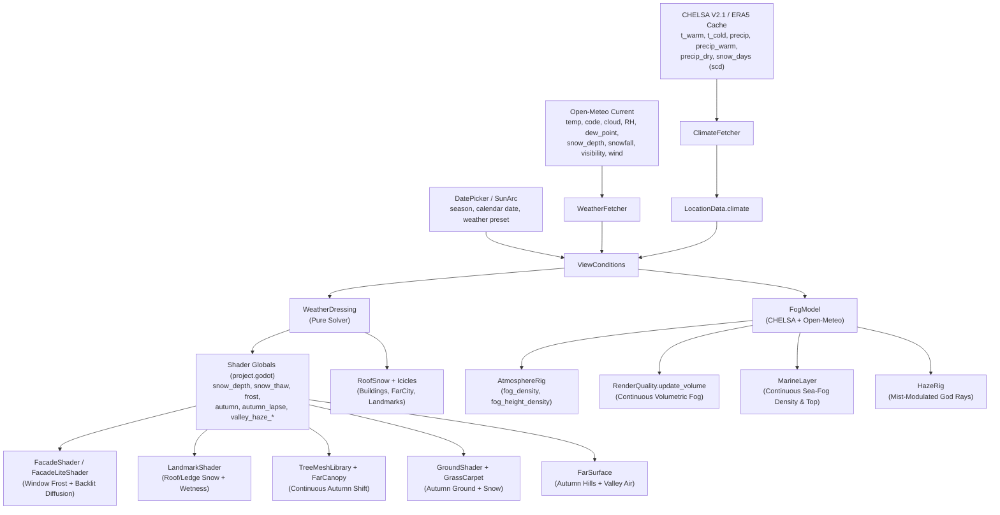

# Plan: Weather-Driven Dressing Beyond Rain

> Status: proposed (2026-11-24). Covers four weather/climate dressing extensions built on top of the existing seasonal sky, `ClimateModel` shader globals, `WeatherLook`, `RoofSnow`, and `ViewConditions.dress` layer:
> 1. **Snow accumulation on roofs** (continuous depth, drift/aspect physics, thaw/slush, and landmark roofs)
> 2. **Frost on windows** (crystalline rime/hoarfrost with heated-room diffusion across facade tiers)
> 3. **Autumn foliage color shift** (continuous CHELSA + date + elevation phenology across near trees, impostors, far canopy, and distant forested hills — with zero world rebuild)
> 4. **Fog density tied to CHELSA / Open-Meteo** (continuous visibility, dew-point/humidity mist, climatological moisture baseline, volumetric fog, marine layer, and valley air)

---

## 1. Goal & Architectural Thesis

Extend the existing live weather and seasonal dressing layer so a place's buildings, windows, trees, distant hillsides, and air respond continuously and physically to **real CHELSA V2.1 climatology** and **live Open-Meteo weather** (plus picked calendar dates and Conditions presets) — **without rebuilding the 3D world** when weather arrives, presets change, or calendar dates are scrubbed within a season.

### Core Principle: Instant, Cache-Safe Dressing

Every live weather response must follow the invariant already established by `ClimateModel.SNOW_GLSL`, `RoofSnow`, and `tests/roof_snow_test.gd`:
- **Never mutate shared `StandardMaterial3D` resources** on a live world (a world is packed and saved to `WorldCache` on a background thread; mutating shared materials breaks it with `"Resource was not pre cached"`).
- Drive continuous surface state through **Godot global shader parameters** (`project.godot` `[shader_globals]`), **per-instance `material_overlay`**, and **AtmosphereRig / MarineLayer / HazeRig** parameters.
- Preserve **world-origin continuity** (`world_origin_m`) in all new procedural noise/hashes so patterns never jump across `WorldStreamer` centre swaps.

---

## 2. Current-State Audit (Grounded in Codebase)

| Area | Current Implementation | Line Count | What Works Today | Gaps to Close |
|---|---|---|---|---|
| **Live weather fetch** | `scripts/data/weather_fetcher.gd` | 89 | Fetches `temperature_2m`, `weather_code`, `cloud_cover`, `utc_offset_seconds`, `elevation` from Open-Meteo. | Missing `relative_humidity_2m`, `dew_point_2m`, `snow_depth`, `snowfall`, `wind_speed_10m`, and `visibility` (single free Open-Meteo call). Live `temp_c` is shown on the HUD chip only and never passed to `ClimateModel` or `AtmosphereRig`. |
| **Climate fetch & model** | `scripts/data/climate_fetcher.gd`, `scripts/generation/climate_model.gd` | 330 / 447 | Fetches CHELSA `bio10` (`t_warm_c`), `bio11` (`t_cold_c`), `bio12` (`precip_mm`), `bio17` (`precip_dry_mm`), `bio18` (`precip_warm_mm`), `scd` (`snow_days`) with ERA5 fallback. Computes snowline, treeline, biome, aridity, `grass_tint`, `water_frozen`, and 8 shader globals. | `snow_days` (`scd`) is fetched and cached but **unused**. No snowpack depth model, no frost potential model, no continuous autumn phenology model, no climatological moisture/fog index. |
| **Roof snow & icicles** | `scripts/render/roof_snow.gd`, `scripts/render/icicles.gd` | 132 / 187 | `RoofSnow` applies a shared `material_overlay` on `Buildings` & `FarCity` roof-tagged meshes; wet-roof sheen in rain. `Icicles` places eave cones on Ultra when `snow_on && cold(data)`. | Binary snow on/off (fixed 3–11 cm push, fixed slope cutoff) regardless of light dusting vs deep snowpack. No sun-aspect melt, no wind-drift or thaw/slush state. **Landmarks** (`LandmarkShader` / `Landmarks` subtree) have no snow or wetness at all. `Icicles` ignores live `temp_c`. |
| **Windows & facades** | `scripts/generation/facade_shader.gd`, `scripts/generation/facade_lite_shader.gd`, `scripts/generation/landmark_shader.gd` | 549 / 199 / 319 | `FacadeShader` (Ultra) has per-pane UV cells (`cuv`), `pane` mask, interior mapping, Fresnel glass, night lights, sill snow, and raindrop streaks. `FacadeLiteShader` (Balanced/High) has per-cell night lights. | **Zero window frost** on any tier. `FacadeLiteShader` and `LandmarkShader` do not consume `// @SNOW` or weather globals. |
| **Foliage & autumn** | `scripts/generation/tree_mesh_library.gd`, `scripts/generation/tree_species.gd`, `scripts/generation/vegetation_builder.gd`, `scripts/generation/far_canopy.gd`, `scripts/generation/far_surface.gd`, `scripts/generation/ground_shader.gd`, `scripts/generation/grass_carpet.gd` | 428 / 505 / 518 / 309 / 521 / 544 / 436 | Four discrete baked season tints (`TINTS`), fixed autumn scatter in `_instance_tint`, fixed autumn grass palette. Live snow load and rain wetness in `LEAF_SHADER` / `IMPOSTOR_SHADER`. | Autumn is a single static baked step: scrubbing dates (`Sep 10 → Oct 15 → Nov 15`) does nothing. No CHELSA thermal timing, no elevation advance, no species onset staggering, no cool-snap response. **`FarSurface` forested slopes stay summer-green** in autumn; `FarCanopy` ignores autumn tinting. |
| **Fog, haze & marine layer** | `scripts/render/weather_look.gd`, `scripts/render/atmosphere_rig.gd`, `scripts/render/render_quality.gd`, `scripts/render/marine_layer.gd`, `scripts/render/haze_rig.gd` | 92 / 735 / 170 / 121 / 373 | `WeatherLook` maps WMO codes to fixed `visibility_m` table; `AtmosphereRig` sets `fog_density`, inland `fog_height_density`, `far_fog_density`; `MarineLayer` draws coastal fog slab; `RenderQuality.update_volume` sets volumetric fog. | Clear-air haze ignores CHELSA humidity/aridity (only `abs(lat) < 20`). No live humidity / dew-point-spread mist or Open-Meteo `visibility`. Volumetric fog and `MarineLayer` are **binary** (`foggy` true/false). `FarSurface` valley air fill (`0.42`) and scale height (`2500 m`) are hardcoded constants. |
| **View orchestration & UI** | `scripts/screens/view_360.gd`, `scripts/screens/view_conditions.gd`, `scripts/screens/date_picker.gd` | **995** / 450 / 304 | `ViewConditions` wires weather arrival, Conditions sheet presets (`DatePicker.WEATHER`), date picking, and `dress()` (also called during `WorldHandoff` staging). | **`View360` is at 995/1000 lines** — zero new inline code may go into `View360`. Picking a Conditions weather preset (e.g. Snow, Fog) does not synthesize matching physical weather telemetry (`temp_c`, `rh`, `snow_depth`, `visibility_m`). |

---

## 3. Architecture & Class-Size Budget

To respect the 1000-line per-class limit (`tools/check_class_size.sh`) and keep every responsibility clean and unit-testable headless:

### New Focused Classes

| New File | Role | Est. Lines | `WorldCache.SOURCE_SKIP`? |
|---|---|---|---|
| `scripts/render/weather_dressing.gd` (`WeatherDressing`) | Pure, stateless solver computing the unified dressing state Dictionary from `(LocationData, weather: Dictionary, date: Dictionary, solar_elev: float)` — snow depth & thaw, window frost potential, autumn phenology & elevation lapse, and preset weather synthesis. Applies globals via `RenderingServer`. | ~280 | Yes (runtime-only dressing, never runs inside `TerrainBuilder`) |
| `scripts/render/fog_model.gd` (`FogModel`) | Pure atmospheric extinction & mist model combining CHELSA climatological moisture/aridity with Open-Meteo `visibility`, `relative_humidity_2m`, `dew_point_2m`, `temperature_2m`, WMO code, solar elevation, and coastal/valley flags → outputs `fog_per_m`, `height_fog_density`, `volumetric_density`, `marine_amount`, `marine_vis_m`, `marine_top_m`, `valley_air_gain`, `haze_scale_m`. | ~220 | Yes (runtime-only, consumed by `AtmosphereRig`) |
| `scripts/generation/weather_glsl.gd` (`WeatherGlsl`) | Shared GLSL snippets spliced into shaders: `FROST_GLSL` (crystalline dendritic window frost + anti-aliased edge fade) and `AUTUMN_GLSL` (elevation-aware autumn hue/chroma shift & per-tree phenology jitter). Keeps `ClimateModel`, `FacadeShader`, `TreeMeshLibrary`, and `FarSurface` compact and DRY. | ~180 | No (spliced into built shaders — changes must invalidate world cache) |

### Line-Count Impact on Existing Classes

- `scripts/screens/view_360.gd` (995 lines): **+0 lines** (keep `_live_weather` as a Dictionary or pass `_weather.current` through `ViewConditions` without adding fields/methods to `View360`; if needed, store extended live weather inside `ViewConditions` static/weak-ref state or replace the untyped `_live_weather` Array contents with `[temp, label, cloud, code, extras_dict]` — 0 new lines!).
- `scripts/render/atmosphere_rig.gd` (735 → ~760 lines): delegates fog/mist/marine/volume math to `FogModel`.
- `scripts/generation/climate_model.gd` (447 → ~510 lines): adds `moisture_index()`, `snowpack_index()`, `autumn_window()`, keeps `SNOW_GLSL` compact (adds `climate_snow_depth` and `climate_snow_thaw` uniforms).
- `scripts/render/roof_snow.gd` (132 → ~210 lines): continuous depth/pillow/drift/aspect/thaw shader + landmark roof support.
- `scripts/generation/facade_shader.gd` (549 → ~600 lines): splices `// @FROST`, integrates pane frost + heated-room melt + backlit diffusion.
- `scripts/generation/facade_lite_shader.gd` (199 → ~235 lines): lightweight perimeter glass frost for Balanced/High.
- `scripts/generation/landmark_shader.gd` (319 → ~365 lines): splices `// @SNOW` for roof/ledge snow accumulation + rain wetness on landmarks.
- `scripts/generation/tree_mesh_library.gd` (428 → ~475 lines): splices `// @AUTUMN`, adds `autumn_profile` / `deciduous` uniforms to `LEAF_SHADER` & `IMPOSTOR_SHADER`.
- `scripts/generation/far_surface.gd` (521 → ~565 lines): splices `// @AUTUMN` for distant forested slopes + reads `valley_haze_amount` / `valley_haze_scale`.
- `scripts/generation/ground_shader.gd` (544 → ~570 lines): subtle live autumn turf/litter shift via `climate_autumn`.
- `scripts/screens/view_conditions.gd` (450 → ~510 lines): wires `WeatherDressing` + `FogModel`, passes live weather dict + date to `apply_surface_state`, and calls `apply_surface_state(v, false)` on intra-season date changes.

### Data Flow



---

## 4. Shared Shader Global Contract (`project.godot`)

Add the following entries under `[shader_globals]` in `project.godot` and register them in `ClimateModel.GLOBALS` (checked by `tests/climate_test.gd`):

| Global Uniform | Type | Range / Default | Driven By | Consumed By |
|---|---|---|---|---|
| `climate_snow_depth` | `float` | `0.0..1.0` (default `0.0`; `1.0` ≈ ≥0.50 m pack) | `WeatherDressing` | `RoofSnow`, `LandmarkShader`, `GroundShader`, `StreetSnow` |
| `climate_snow_thaw` | `float` | `0.0..1.0` (default `0.0`; `1.0` = wet/slushy melt) | `WeatherDressing` | `RoofSnow`, `GroundShader`, `StreetSnow` |
| `climate_frost` | `float` | `0.0..1.0` (default `0.0`) | `WeatherDressing` | `FacadeShader`, `FacadeLiteShader`, `LandmarkShader` (glass/trim) |
| `climate_autumn` | `float` | `0.0..1.0` (default `0.0`; `0` = green, `0.65` = peak, `1.0` = late russet) | `WeatherDressing` | `TreeMeshLibrary` (leaf + impostor), `FarSurface`, `GroundShader`, `GrassCarpet`, `GroundCover` |
| `climate_autumn_lapse` | `float` | `float` (default `0.0`; progress delta per render Y unit) | `WeatherDressing` | `TreeMeshLibrary`, `FarSurface` |
| `valley_haze_amount` | `float` | `0.0..1.0` (default `0.42`) | `FogModel` via `AtmosphereRig` | `FarSurface` |
| `valley_haze_scale` | `float` | `float` (default `2500.0`; metres scale height) | `FogModel` via `AtmosphereRig` | `FarSurface` |

**Zero-cost idle guarantee:** Every shader early-outs (`if (climate_frost <= 0.005)`, `if (climate_autumn <= 0.005)`, `if (climate_snow_depth <= 0.005)`) so summer/clear scenes pay virtually zero extra ALU and remain pixel-identical to current golden captures (AC-12).

---

## 5. Detailed Subsystem Designs

### 5.1 Data Layer Extension (`WeatherFetcher`, `ClimateFetcher`, `WeatherDressing`)

#### A. `WeatherFetcher` (Open-Meteo — zero extra round trips)
Extend `URL_TEMPLATE` in `scripts/data/weather_fetcher.gd` to request the extra live surface fields in the same JSON call:
```
current=temperature_2m,relative_humidity_2m,dew_point_2m,weather_code,cloud_cover,snowfall,snow_depth,wind_speed_10m,wind_direction_10m
```
*(Phase 0 verification item: test against live Open-Meteo whether `visibility` is accepted directly in `current=`; if not, add `&hourly=visibility&forecast_days=1` and read the index matching `current.time` — adds ~400 bytes to the same response, still 1 HTTP request and 0 extra round trips!)*

- **Backward compatibility:**
  - Keep `signal succeeded(temp_c: float, label: String, cloud_cover: float, code: int)` unchanged so all callers and tests keep working.
  - Store the full parsed dictionary on `WeatherFetcher.current_data: Dictionary` with safe defaults when keys are absent (e.g. `has_humidity`, `has_snow_depth`, `has_visibility` flags or `NAN` sentinels so offline/minimal fixtures like `tests/weather_test.gd` never treat missing `0.0` as "0% humidity" or "0 m visibility"!).
  - In `ViewConditions._on_weather`, stash `v._weather.current_data.duplicate()` as the 5th element of `v._live_weather` (avoiding any new member variable on 995-line `View360`).
- **HostPolicy:** Still strictly `api.open-meteo.com` — zero new hosts.

#### B. `ClimateFetcher` & `ClimateModel` (CHELSA V2.1 — zero extra round trips by default)
- `ClimateFetcher` already downloads and caches 6 CHELSA GeoTIFFs (`t_warm_c`, `t_cold_c`, `precip_mm`, `precip_warm_mm`, `precip_dry_mm`, `snow_days`) within `CHELSA_BUDGET_S = 14.0`.
- **Decision on extra CHELSA GeoTIFFs:** Adding another CHELSA GeoTIFF (like `hurs_mean`) adds 3 HTTP range round trips (~6–9 s against SWITCH object store) and risks pushing fetches past `CHELSA_BUDGET_S`. Instead:
  1. Unlock the **already-cached `snow_days` (`scd`)** and full precipitation/temperature set (`t_warm_c`, `t_cold_c`, `precip_mm`, `precip_warm_mm`, `precip_dry_mm`) in `ClimateModel` — zero latency cost, works on every existing cached climate JSON!
  2. Derive three calibrated climatological indices in `ClimateModel`:
     - **`snowpack_index(data, season, date)` (`0.0..1.0`)**: combines `snow_days` (0..220 d), `season_temp_c` / `month_temp_c` (how far below freezing), and cold-half precipitation `(precip_mm - precip_warm_mm)`. Example outputs: Paris winter `0.0`, Interlaken valley winter `0.10` (high slopes `0.85`), Helsinki/Turku winter `0.62`, Banff winter `0.88`.
     - **`moisture_index(data)` (`0.0..1.0`)**: de Martonne / Köppen humidity proxy `clamp((precip_mm / max(t_mean + 10.0, 5.0)) / 55.0, 0.0, 1.0)` modulated by seasonal dryness (`summer_dry`, `winter_dry`, `arid`). Example outputs: Cairo `0.01`, Big Sur summer `0.25` / winter `0.78`, Paris `0.58`, Helsinki `0.66`, Interlaken `0.92`, Singapore/Bangkok monsoon `0.95`.
     - **`continentality(data)` (`0.0..1.0`)**: `clamp((t_warm_c - t_cold_c - 6.0) / 24.0, 0.0, 1.0)` — separates crisp maritime air (Reykjavik, Big Sur) from continental cold-dry winters (Banff) and early autumn chill.
  3. On the Open-Meteo ERA5 fallback (`FALLBACK_URL`), optionally request `relative_humidity_2m_mean` in the same daily archive URL to populate `rh_mean` when ERA5 is used (Phase 0 check on payload size).

#### C. Weather Preset Synthesis (`WeatherDressing.weather_for_pick`)
When the user picks a Conditions sheet preset (`DatePicker.WEATHER`: Clear, Cloudy, Fog, Rain, Heavy rain, Snow, Storm) instead of `Live`:
- Synthesize a physically coherent `weather` dictionary anchored to the place's CHELSA/seasonal temperature (never leaking stale live summer temp into a Winter+Snow preview, or vice versa!):
  - **Snow (code 73):** effective temp `min(seasonal_temp, -2.5 °C)`, `rh = 88%`, `snow_depth = max(climate_pack, 0.22 m)`, `snowfall = 1.8 cm/h`.
  - **Fog (code 45 — or 48 when seasonal temp ≤ -1 °C!):** `rh = 98%`, `dew_point = temp - 0.3 °C`, `visibility = 450 m` (triggers freezing rime fog + frost automatically in cold climates!).
  - **Clear (code 0):** `rh = 48%` (arid `20%`), `visibility = 28000 m`; in cold winter morning (`temp < -2 °C`), radiative frost can still form gently!
  - **Rain / Heavy rain / Storm:** `rh = 90–95%`, `snow_depth = 0.0` (or slushy thaw if seasonal snow lies).

---

### 5.2 Pillar 1 — Snow Accumulation on Roofs

#### Goals
Replace the binary white sheet in `RoofSnow` with realistic, depth-driven roof snow accumulation that reflects live snowfall/snow-depth + CHELSA winter climate, respects roof geometry (pitch, aspect, wind drift), handles melt/slush, and extends to landmarks.

#### Design Details
1. **Accumulation Driver (`climate_snow_depth`, `climate_snow_thaw`):**
   - Computed in `WeatherDressing.snow_state(data, weather, date)`:
     - **Live mode with `snow_depth` present:** `live_d = smoothstep(0.01, 0.50, snow_depth_m)`. Active snowfall (`snowfall > 0` or `code in SNOWING`) adds a fresh-dusting floor `clamp(0.08 + 0.25 * intensity, 0.0, 0.45)` when `temp_c <= 1.5 °C`.
     - **Seasonal / preset mode (or `snow_depth` absent):** uses `ClimateModel.snowpack_index(data, season, date)` when `snowy_at_viewpoint` or above the snow line; active Snow preset guarantees `>= 0.45` at cold/moderate places.
     - **Thaw / slush (`climate_snow_thaw`, `0..1`):** rises when snow is present AND (`temp_c` is in `[-0.5 °C, +3.5 °C]` OR `code in RAINING` — rain-on-snow!).
2. **`RoofSnow.SHADER` Enhancements (`scripts/render/roof_snow.gd`):**
   - **Depth-scaled vertex pillowing:**
     ```glsl
     float flat_k = smoothstep(0.45, 0.90, wny);
     float push = 0.02 + (0.04 + 0.18 * climate_snow_depth) * flat_k;
     VERTEX += NORMAL * push;
     ```
     Flatter roofs accumulate thicker rounded cushions (up to ~24 cm visual lift); steep pitches stay tight to the roof tiles so snow never floats off mansards or pokes through dormers.
   - **Progressive slope shedding & coverage:**
     - Effective slope threshold tightens at low depth and relaxes slightly at high depth: steep roofs (`wny ~ 0.35–0.55`) stay mostly bare under a 5 cm dusting (`depth = 0.15`) and only hold patchy snow under deep pack (`depth > 0.6`), while flat roofs (`wny > 0.85`) catch snow immediately.
     - **Aspect-aware solar melt:** read `cloud_sun_dir` (and hemisphere `sun_side` or world-Z facing) so sun-facing roof slopes thin earlier when `climate_snow_thaw > 0` or `climate_snow_depth < 0.5`, while north/shaded pitches stay thick.
     - **Wind-drift redistribution:** align multi-scale drift ripples along `WaterShader.WIND` (`vec2(0.86, 0.51)`), using `hp = wpos.xz + world_origin_m` for streaming continuity.
     - **Warm-roof melt patches:** low-frequency metre-scale warm spots (heat loss around chimneys/ridges) thin out first when `climate_snow_thaw > 0.1` or `depth < 0.4`, revealing dark roof tiles beneath with a rounded `snow_edge` lip!
     - **Fresh powder vs wet slush material response:** pass `age = climate_snow_thaw * 0.55` to `snow_albedo()`, lower roughness toward `0.42` and slightly darken edges during thaw; enable `snow_facet` sparkle when dry powder (`climate_snow_thaw < 0.3`).
3. **Landmark Roofs & Ledges (`LandmarkShader` + `RoofSnow`):**
   - Splice `// @SNOW` into `scripts/generation/landmark_shader.gd`:
     - On `Kind.BUILT`, `Kind.ASHLAR`, and `Kind.METAL` (skipping `grime < 0.5` bright gilding only lightly, or allowing dusting on flat copings/domes), apply `snow_cover` scaled by `climate_snow_depth` on upward-facing surfaces (`up = smoothstep(0.45, 0.80, n.y)`), using world position `wpos` (add `varying vec3 wpos` to `LandmarkShader`) and `world_origin_m`.
     - Add rain wetness darkening + roughness drop (`climate_wetness * (1.0 - sc)`) on landmarks too — closing the rain parity gap on hero monuments!
   - Keep `RoofSnow.apply(world, on, wet)` untouched in contract for `Buildings` and `FarCity`, and verify whether non-`LandmarkShader` tiers (Fast/Balanced/High `StandardMaterial3D` landmarks) should also receive `RoofSnow.overlay()` on roof-tagged landmark meshes (check `LandmarkRoofs` / `HeroLook` meta `"roof"` — `HeroLook` ALREADY sets `meta("roof", true)`!). Extending `RoofSnow.apply` to inspect `"Landmarks"` meshes carrying `meta("roof")` gives automatic Fast/Balanced/High landmark roof snow with zero shared-material mutation!
4. **`Icicles` Coupling (`scripts/render/icicles.gd`):**
   - Update `Icicles.cold(data, weather)` to honor live `temp_c <= 0.5 °C` (with `climate_snow_depth >= 0.15`) in addition to CHELSA `season_temp_c < COLD_C`.
   - Freeze-thaw realism: icicles grow longest when snowpack is present (`climate_snow_depth >= 0.25`) and temperatures hover near freeze-thaw (`-6 °C .. +0.5 °C`); hide when `climate_snow_depth < 0.08`.

---

### 5.3 Pillar 2 — Frost on Windows

#### Goals
Add physically motivated, anti-aliased frost and rime crystals on building windows during freezing damp weather, freezing fog, and sub-zero winter mornings — with authentic perimeter-inward crystal growth, heated-room melting, and warm backlit night diffusion.

#### Design Details
1. **Frost Driver (`climate_frost`, `0.0..1.0`):**
   Computed in `WeatherDressing.frost_amount(data, weather, date, solar_elev)`:
   - **Temperature gate (`t_eff`):** uses live `temp_c` if available, else CHELSA `month_temp_c` / `season_temp_c` (or latitude winter fallback).
     - `cold_k = smoothstep(1.5, -7.0, t_eff)` (zero above `+1.5 °C`, half around `-2.5 °C`, full below `-7 °C`).
   - **Moisture / deposition gate:**
     - **Live Open-Meteo:**
       - WMO `48` (depositing rime fog) or `56/57/66/67` (freezing drizzle/rain): `moist_k = 1.0`.
       - Otherwise from dew-point spread `spread = max(temp_c - dew_point_c, 0.0)` and `rh`:
         `moist_k = max(smoothstep(6.0, 0.5, spread), smoothstep(62.0, 92.0, rh) * 0.85)`.
       - Active snow (`code in SNOWING`): floor `moist_k >= 0.55`.
     - **Seasonal / preset fallback (no live RH):**
       - `moist_k = ClimateModel.moisture_index(data) * 0.85` (suppressed in arid climates where `arid(data)` → `0.1`, boosted to `1.0` for Fog/Snow presets when cold).
   - **Diurnal solar factor:**
     - Radiative frost peaks at night & dawn (`solar_elev <= 6°`: `1.0`) and eases gently by midday sun (`smoothstep(24.0, 6.0, solar_elev)` mapped to `[0.55, 1.0]`, plus per-wall sun-facing melt in the shader!).
   - Final global: `climate_frost = clamp(cold_k * moist_k * diurnal_k, 0.0, 1.0)`.
   - Sanity checks:
     - Helsinki Jan `-8 °C`, `RH 88%` → `~0.85`
     - Helsinki Jan `-3 °C`, WMO `48` (rime fog) → `~0.95`
     - Paris Jul `+24 °C` → `0.0`
     - Paris Jan `+5 °C` → `0.0` (but Paris Jan `-3 °C`, `RH 92%` live cold snap → `~0.55`!)
     - Cairo / Miami / Bangkok any season → `0.0`

2. **Shared Frost GLSL (`WeatherGlsl.FROST_GLSL`):**
   Spliced at `// @FROST` into `FacadeShader` (and a lightweight subset into `FacadeLiteShader`):
   - **Input per pane:** `cuv` (0..1 within pane), `pane_px` (footprint size for anti-aliasing), `seed` (per-pane hash), `lit` (0..1 room lamp state), `curtain_wall` (bool), `wnrm` (world normal for solar-facing melt).
   - **Perimeter-inward mask:**
     - Distance from glass edge: `vec2 ed = min(cuv, 1.0 - cuv);` with extra weighting toward the bottom sill (`cuv.y > 0.5` cools/condenses most).
     - Base reach grows with `climate_frost`, reduced on modern triple-glazed `curtain_wall` (`* 0.45`), reduced on warmly `lit` rooms (`* 0.65`, leaving a clear thawed oval in the center!), and reduced on direct sunlit faces (`dot(wnrm, cloud_sun_dir) > 0.25` when `cloud_sun_dir.y > 0.15`).
   - **Dendritic fern / rime crystal noise:**
     - Two-scale domain-warped high-frequency ridge noise in pane-local space (`cuv * vec2(7.0, 9.0) + seed * 19.0`) + fine crystal sparkle scale (`cuv * 28.0`), both **filtered smoothly to their mean** via `smoothstep(0.015, 0.06, pane_px)` so distant facades never alias or sparkle!
   - **Outputs:** `frost_cover` (0..1), `frost_normal` (2D micro-crystal tilt in tangent space), `frost_glint` (subtle ice crystal specular catch).

3. **Material Integration in `FacadeShader` (Desktop Ultra):**
   When `climate_frost > 0.005 && pane > 0.05`:
   - `glass_alb = mix(glass_alb, vec3(0.82, 0.89, 0.96), frost * 0.82);`
   - `pane_rough = mix(pane_rough, 0.62, frost);` (breaks sharp reflections into frosted matte ice)
   - `METALLIC` on pane drops: `mix(pane_metallic, 0.04, frost)`
   - `SPECULAR` stays crisp dielectric ice (`0.55`, lifted slightly on `frost_glint * climate_snow_glint`)
   - **Warm backlit diffusion (night & dusk):** behind frosted glass, blend the sharp interior-traced `glass_e` toward a soft uniform diffused glow `lamp * lit * night_energy * 0.68 * vec3(1.0, 0.92, 0.82)`, so lit Nordic windows glow softly through frosted panes instead of showing sharp furniture silhouettes through ice!
   - `NORMAL_MAP` on pane adds `frost_normal * 0.14 * near_glass` (clamped inside unit disc).
   - Suppression of raindrop streaks when frost is active (`climate_rain * (1.0 - frost)`).

4. **Balanced / High (`FacadeLiteShader`) & Fast / Mobile Scaling:**
   - In `FacadeLiteShader`: read `global uniform float climate_frost;`. Identify glass pixels using existing `rough_tex` (`pane = has_normal ? smoothstep(0.32, 0.22, rough) : 0.0`). Compute a cheap 4-line perimeter mask from `fract(UV * cells)` faded by `bay_px`, shifting `ALBEDO` toward cool ice-white, lifting `ROUGHNESS` toward `0.60`, and softly warming frosted lit cells. Zero extra texture fetches; zero cost when `climate_frost <= 0.005`.
   - Fast / Mobile (`StandardMaterial3D` facades): keep untouched to preserve `WorldCache` safety and mobile fragment budget (optional future follow-up: per-instance frost overlay if ever needed on mobile, not in initial scope).

---

### 5.4 Pillar 3 — Autumn Foliage Color Shift

#### Goals
Transform autumn from a single static baked tint into a **continuous, climate- and elevation-aware seasonal color progression** driven by CHELSA thermal normals, calendar date, and live Open-Meteo temperature — updating trees, impostors, far canopy, distant forested hillsides (`FarSurface`), and ground cover instantaneously with **zero world rebuild** when scrubbing dates.

#### Design Details
1. **Phenology Model (`WeatherDressing.autumn_state(data, weather, date)`):**
   - **Tropical / arid / evergreen-only suppression:**
     - If `ClimateModel.has(data)` and `t_cold_c >= 13.0` (e.g. Miami, Bangkok, Singapore, Cairo, Rio) → `climate_autumn = 0.0`.
     - If `ClimateModel.arid(data)` → `0.0`.
   - **Calendar day-of-year (`doy`, hemisphere-normalized):**
     - Source date: explicit `v._date` if picked, else live calendar date if `v._live_time`, else season mid-month (`AtmosphereRig.solar_date()`).
     - Southern hemisphere (`lat < 0`) shifts by 182.5 days so April/May maps to northern October/November.
   - **CHELSA thermal peak day (`peak_doy`):**
     - Derived from `t_cold_c` and `t_warm_c` (or `abs(lat)` fallback):
       - Boreal / cold-winter (`t_cold_c <= -4 °C`, e.g. Banff, Helsinki, Turku): peak around **doy 278 (Oct 5)**, window ~50 days (`Sep 10 – Oct 30`).
       - Cool temperate (`t_cold_c ~ 0..4 °C`, e.g. Stockholm, Interlaken, NYC, Paris): peak around **doy 295 (Oct 22)**, window ~55 days (`Sep 25 – Nov 20`).
       - Warm temperate (`t_cold_c ~ 5..11 °C`, e.g. Tokyo, Seoul, Kyoto, Rome): peak around **doy 320 (Nov 16)**, window ~50 days (`Oct 20 – Dec 10`).
     - Continuous curve `progress`:
       - Ramps `0.0 → 0.70` (green → early gold → peak flame) from `peak_doy - half_win` to `peak_doy`, and `0.70 → 1.0` (peak → late russet/bronze) from `peak_doy` to `peak_doy + half_win * 0.8`.
       - When `data.season == AUTUMN` and no explicit date is picked (mid-season default), guarantee `progress` lands cleanly near `0.68` (preserving rich mid-autumn color on the Autumn button!).
       - When `data.season == SUMMER` with an explicit September date (e.g. `Sep 18` in Helsinki/Banff), `progress` can already reach `0.25–0.45` — seamless late-summer → early-autumn transition!
   - **Live Open-Meteo chill nudge:**
     - Only active inside the autumn phenological window (`progress > 0.05`): if live `temp_c` is below the CHELSA monthly mean `month_temp_c(data, month)`, nudge `progress` up by `clamp((normal_c - temp_c) * 0.015, -0.06, 0.12)`. A freak cold day in July (`progress == 0`) stays `0.0`.
   - **Elevation lapse (`climate_autumn_lapse`):**
     - Cool mountain air advances foliage by ~3–4 days per 100 m of elevation (`~0.00055` progress per metre above viewpoint, zero in flat coastal/tropical zones). Higher Alpine/Rocky slopes turn gold ahead of valley floors!

2. **Decoupling Static Season Bake from Live Autumn Shift (Zero-Rebuild Strategy):**
   - **Key design insight:** Today `TreeMeshLibrary.mesh(sp, lod, season, snow)` bakes `TreeSpecies.tint(sp, season)` directly into the material's `tint` uniform, so an `AUTUMN`-built world already has orange `tint` baked in, while a `SUMMER`-built world has green `tint`.
   - To make live `climate_autumn` work cleanly on **both** `SUMMER` and `AUTUMN` built worlds (without double-shifting orange into neon red on `AUTUMN` builds!):
     - Give `LEAF_SHADER` and `IMPOSTOR_SHADER` two species-specific uniforms set once at material creation in `TreeMeshLibrary`:
       - `uniform vec3 summer_tint : source_color;` (always the species' green/base tint)
       - `uniform vec3 autumn_tint : source_color;` (the species' peak autumn target — birch bright gold, maple/rowan crimson-orange, oak russet-amber, lime yellow-gold, evergreens equal to `summer_tint`!)
       - `uniform vec3 autumn_meta = vec3(0.0, 0.0, 0.0);` where:
         - `.x` = `deciduous` (`0.0` for evergreens/conifers/palms, `1.0` for deciduous; `0.0` for winter bare twigs!)
         - `.y` = species onset offset (`-0.15` early turners like birch/horse_chestnut, `0.0` lime/plane/maple, `+0.15` late turners like oak!)
         - `.z` = crimson/scarlet mid-phase accent (`0.8` for maple/rowan/sweetgum, `0.25` for oak/horse_chestnut, `0.0` for yellow birch/ginkgo/lime!)
     - In `TreeMeshLibrary`: for `SPRING`, `tint` stays fresh spring green; for `SUMMER` and `AUTUMN`, the base `tint` starts at `summer_tint` and the shader blends smoothly `summer_tint → early_gold → peak(autumn_tint / crimson) → late_russet` using **live `climate_autumn` + elevation lapse + per-tree jitter**!
     - **Huge win:** Switching between `Sep 5`, `Sep 25`, `Oct 15`, `Nov 5`, and `Nov 20` in `DatePicker` (and even `Summer ↔ Autumn` visually!) updates every tree in the entire world in **< 1 ms**, with asynchronous tree-by-tree progression and zero LOD-popping across LOD 0, LOD 1, LOD 2, and `FarCanopy`!
     - *(Note: `Winter` still rebuilds as today because deciduous trees swap to bare-twig geometry meshes, and `Spring` keeps its fresh yellow-green shoots.)*

3. **Per-Tree & Within-Crown Realism (`WeatherGlsl.AUTUMN_GLSL`):**
   - Per-tree phenology hash from `MODEL_MATRIX[3].xz + world_origin_m`: gives ±0.16 spread so in early/mid autumn some trees are still olive-green while neighbours blaze gold or scarlet (replaces the coarse 3-bucket `_instance_tint` hack in `VegetationBuilder` with continuous spatial coherence, and automatically fixes `FarCanopy` too!).
   - **Within-crown gradient:** outer & upper sunlit leaves (`up > 0.2`, high AO) turn slightly ahead of shaded lower interior leaves (`+0.08` progress), giving real multi-tone canopies instead of monochrome orange balls.
   - **Translucency (`BACKLIGHT`) shift:** as leaves turn gold/crimson, update `BACKLIGHT` from green-yellow to warm amber-red glow so low autumn sun lights crowns from behind!

4. **Distant Forested Hills (`FarSurface`) & Ground Harmony (`GroundShader`, `GrassCarpet`, `GroundCover`):**
   - **`FarSurface` (`scripts/generation/far_surface.gd`):**
     - Pass one per-world uniform `deciduous_share` (0.0..1.0, computed from the place's `TreeSpecies.biome_for_data(data)` forest mix — e.g., `0.0` in tropical/arid, `0.25` in alpine/boreal spruce-birch, `0.65` in temperate oak-lime-maple).
     - Where `forest > 0.01 && climate_autumn > 0.01 && sc < 0.9` (below `treeline_y`):
       - Compute elevation-advanced `aut = clamp(climate_autumn + wpos.y * climate_autumn_lapse, 0.0, 1.0)`.
       - Use existing `stands` + `crowns` noise to create patchy deciduous stands (gold/amber/russet) interspersed with dark evergreen conifer patches (`smoothstep(1.0 - deciduous_share, 1.0, stand_mix)`).
       - Shift `c` luminance-preservingly from summer satellite green toward warm autumn palette — eliminates the stark summer-green mountainside behind autumn foreground trees!
   - **`GroundShader`, `GrassCarpet`, `GroundCover`:**
     - Subtle live `climate_autumn` shift on lawn/meadow/forest-floor weights (`meadow` warms slightly toward golden-olive; `forest` floor gains mottled russet fallen-leaf litter patches as `climate_autumn > 0.45`).
     - In `ViewConditions.set_date`: even when `season == v._data.season` (no rebuild), call `apply_surface_state(v, false)` so `climate_autumn`, `climate_frost`, and fog update immediately on the new date!

---

### 5.5 Pillar 4 — Fog Density Tied to CHELSA / Open-Meteo

#### Goals
Tie atmospheric extinction, height-based valley mist, volumetric fog density, coastal `MarineLayer`, and `FarSurface` valley haze directly to **Open-Meteo live atmospheric state** (`visibility`, `relative_humidity_2m`, `dew_point_2m`, `temperature_2m`, `weather_code`) and **CHELSA climatology** (`moisture_index`, `arid`, `continentality`, `t_cold_c`).

#### Design Details
1. **`FogModel.compute(data, weather, look, season, solar_elev, coastal)` (`scripts/render/fog_model.gd`):**
   Produces one cohesive dictionary consumed by `AtmosphereRig`, `RenderQuality.update_volume`, `MarineLayer`, and `FarSurface`:

   - **Step A — Climatological clear-air baseline (`base_haze_per_m`):**
     Start from `AtmosphereRig.HAZE_PER_M` (`4.5e-5` /m, ≈ 67 km visual range) × `SkyPalette` season haze × **CHELSA factor**:
     - Humid climates (`moisture_index` 0.6..1.0): `1.0 → 1.35x` (more boundary-layer water vapor & biogenic aerosols).
     - Arid climates (`arid(data)`): `1.15 → 1.45x` warm dry dust/aerosol haze (clear in valley mist, slightly hazier on horizon), with subtle warm dust tint shift on `fog_light_color` only when arid + dry.
     - Crisp cold continental/boreal winter (`t_eff < -4 °C`, clear sky, low humidity): `0.65 → 0.85x` (razor-sharp sub-zero mountain/Nordic visibility!).

   - **Step B — Live Open-Meteo hygroscopic mist & visibility (`weather_ext_per_m`):**
     - **If Open-Meteo `visibility_m` is present and valid (`> 0`):**
       - Clamp to `[150.0, 50000.0]` m (never total blind whiteout at 5 m; never zero).
       - `vis_ext = 3.0 / vis_m` (Koschmieder's law).
       - Combine smoothly with WMO code extinction `WeatherLook.fog_per_m(look, base_haze)`:
         - In active precip/fog codes (`vis_wmo > 0`), blend/guard so live `visibility_m` refines WMO density within `[0.4×, 2.5×]` of the WMO class (prevents stale/coarse model visibility from making a heavy blizzard crystal clear).
         - In non-precip codes (0, 1, 2, 3), live `visibility_m` directly drives hazy vs crystal-clear days!
     - **If `visibility_m` is absent (or to supplement coarse visibility), use `relative_humidity_2m` + `dew_point_2m`:**
       - Dew-point depression `spread = max(temp_c - dew_point_c, 0.0)`.
       - Hygroscopic aerosol growth factor (capped):
         - For `RH < 70%`: `1.0` (dry air, baseline holds).
         - For `RH 70%..99%`: smooth ramp `1.0 → 5.5x` baseline; as `spread → 0.5 °C` (near saturation / radiation mist), visibility drops smoothly toward `1200–2500 m` even on a "Partly cloudy" (WMO 2) dawn!
       - **Freezing / ice fog (`temp_c <= -5 °C` & `WMO 48` or `RH >= 92%`):** cooler pale ice-blue scatter tint + slightly sharper forward-scattering `fog_sun_scatter` (diamond-dust halo in low sun!).

   - **Step C — Valley / radiation mist (`fog_height_density` & `FarSurface` valley air):**
     - Replace `AtmosphereRig`'s ad-hoc 3-line inland mist formula with a climate + moisture driven calculation:
       - Scales with `moisture_index` (arid → `0.0`), live humidity / low `spread` (`smoothstep(5.0, 0.5, spread)`), low solar elevation (`low_sun` at dawn/golden hour), and autumn/spring season bias.
       - Sets both Godot's `environment.fog_height_density` (capped so near kerbs never grey out) AND new globals `valley_haze_amount` (`0.08` arid .. `0.42` temperate .. `0.68` humid/misty valley) and `valley_haze_scale` (`1200 m` dense inversion .. `3200 m` dry clear air) read by `FarSurface`!

   - **Step D — Continuous `MarineLayer` (coastal sea fog):**
     - Instead of binary `_coastal and is_foggy()`:
       - Active whenever `_coastal and MarineLayer.supported()` and `marine_amount > 0.02`.
       - Driven by WMO fog (`45/48` → `amount 0.9–1.0`, `vis 400–1200 m`), OR coastal high humidity / low dew-point spread (`RH >= 85%`, `spread <= 2.5 °C` → gentle `amount 0.25–0.65`, `vis 2000–4500 m`, lower ceiling `TOP_M` 90–180 m).
       - Add `MarineLayer.set_profile(top_m, soft_m, visibility_m, units_per_metre)` so dense sea fog thickens and lifts realistically while light coastal mist skims low over the harbour!

   - **Step E — Continuous Volumetric Fog (`RenderQuality.update_volume`) & `HazeRig`:**
     - Replace binary `VOLUME_FOG_PER_M if foggy else VOLUME_PER_M` in `RenderQuality.update_volume`:
       - Map `fog_per_m` continuously on a log/smoothstep ramp from clear (`4.5e-5` → `0.00022`) through humid mist (`3e-4` → `0.00085`) to dense fog (`7.5e-3` → `0.0032`), respecting the Paris 2026-10-30 anti-milking ceiling so clear golden-hour views keep crisp contrast while real fog/mist builds tangible 3D depth!
       - Feed `FogModel`'s effective `visibility_m` into `HazeRig` (`update_from_atmosphere`) so light mist enriches god rays while heavy fog smoothly dissolves shafts into uniform murk.

---

## 6. Phased Implementation Plan

### Phase 0 — Live API & Calibration Verification (No Behaviour Change)
- [ ] Verify Open-Meteo `/v1/forecast` live response fields for a test coordinate (e.g. Helsinki & Interlaken): confirm whether `visibility` is supported in `current=` or requires `&hourly=visibility&forecast_days=1` (read current hour slice). Confirm payload size and latency stay single-request (~1–2 KB).
- [ ] Confirm ERA5 fallback (`archive-api.open-meteo.com`) daily fields if adding `relative_humidity_2m_mean` (verify no timeout regression on 10-year query).
- [ ] Run baseline headless tests (`climate_test.gd`, `weather_test.gd`, `roof_snow_test.gd`, `snow_look_test.gd`, `facade_shader_test.gd`, `sky_test.gd`, `haze_test.gd`, `marine_layer_test.gd`, `world_cache_key_test.gd`, `host_policy_test.gd`) and `tools/check_class_size.sh` to establish clean baseline.

**Validation:** Documented Open-Meteo query contract (commented in `weather_fetcher.gd`) and green baseline test suite.

---

### Phase 1 — Data Layer & Unified `WeatherDressing` Foundation
- [ ] Extend `WeatherFetcher` (`scripts/data/weather_fetcher.gd`):
  - Add `relative_humidity_2m`, `dew_point_2m`, `snowfall`, `snow_depth`, `wind_speed_10m`, `wind_direction_10m` (and `visibility` per Phase 0) to `URL_TEMPLATE`.
  - Parse into `current_data: Dictionary` with explicit presence keys / `NAN` guards; preserve `parse_current()` keys and `succeeded` 4-arg signal for full backward compatibility.
- [ ] Extend `ClimateModel` (`scripts/generation/climate_model.gd`):
  - Add pure static `snowpack_index(data, season, date)`, `moisture_index(data)`, `continentality(data)`.
  - Add `climate_snow_depth`, `climate_snow_thaw`, `climate_frost`, `climate_autumn`, `climate_autumn_lapse`, `valley_haze_amount`, `valley_haze_scale` to `GLOBALS` and `project.godot` `[shader_globals]`.
- [ ] Create `scripts/render/weather_dressing.gd` (`WeatherDressing`):
  - Implement pure static `solve(data, weather, date, solar_elev) -> Dictionary` returning all dressing scalars + `weather_for_pick(pick_index, data, date)` for Conditions sheet presets + `apply_globals(state)`.
  - Register `res://scripts/render/weather_dressing.gd` in `WorldCache.SOURCE_SKIP`.
- [ ] Wire `ViewConditions` (`scripts/screens/view_conditions.gd`) to store extended weather dict in `v._live_weather` (0 new lines in `View360`), pass `(v._data, weather_dict, date, solar_elev)` to `WeatherDressing`, and call `apply_surface_state(v, false)` on intra-season `set_date` calls.
- [ ] Unit tests: extend `tests/weather_test.gd` and `tests/climate_test.gd`, add `tests/weather_dressing_test.gd` testing all 4 pillars' scalar curves across 8 reference cities (Helsinki, Turku, Banff, Interlaken, Paris, Big Sur, Tokyo, Cairo, Bangkok) + offline/missing-field fallbacks.

**Validation:** All headless unit tests pass via `tools/godot_bg.sh`; `View360` remains ≤ 995 lines; `tests/host_policy_test.gd` and `tests/world_cache_key_test.gd` pass.

---

### Phase 2 — Pillar 1: Snow Accumulation on Roofs & Landmarks
- [ ] Update `ClimateModel.SNOW_GLSL`: expose `global uniform float climate_snow_depth;` and `global uniform float climate_snow_thaw;`.
- [ ] Upgrade `RoofSnow.SHADER` (`scripts/render/roof_snow.gd`):
  - Depth-driven vertex pillowing on flatter planes (`climate_snow_depth`), progressive slope shedding, wind-drift streaks along `WaterShader.WIND`, sun-aspect melt bias, warm-roof melt patches with rounded `snow_edge` lips, and thaw/slush albedo/roughness shift (`climate_snow_thaw`).
  - Keep `RoofSnow.apply()` per-instance `material_overlay` (never touch shared materials); extend layer check to include `"Landmarks"` meshes carrying `meta("roof")` (e.g. `HeroLook` roofs on non-Ultra tiers).
- [ ] Upgrade `LandmarkShader` (`scripts/generation/landmark_shader.gd`):
  - Splice `// @SNOW`, add `varying vec3 wpos`, apply depth-driven snow accumulation on upward-facing roofs/copings/ledges (`Kind.BUILT`/`ASHLAR`/`METAL`) and live rain wetness darkening/gloss (`climate_wetness`).
- [ ] Upgrade `Icicles` (`scripts/render/icicles.gd`):
  - Gate `Icicles.cold(data, weather)` on live `temp_c` as well as CHELSA `season_temp_c` and `climate_snow_depth >= 0.15`.
- [ ] Update `tests/roof_snow_test.gd`, `tests/snow_look_test.gd`, and `tests/landmark_shader_test.gd` to assert depth-scaling uniforms, landmark snow/wetness splice, and shared-material immutability.

**Validation:** Headless tests pass; `WorldCache.BUILD_VERSION` bumped once (or deferred to end of Phase 4 in one clean bump).

---

### Phase 3 — Pillar 2: Frost on Windows
- [ ] Create `scripts/generation/weather_glsl.gd` (`WeatherGlsl`) containing `FROST_GLSL` (perimeter-inward dendritic crystal mask, heated-room center melt, solar-aspect easing, `pane_px` anti-aliasing convergence, crystal normal perturbation).
- [ ] Integrate `// @FROST` into `FacadeShader` (`scripts/generation/facade_shader.gd`):
  - Apply frost albedo, high dielectric roughness, low metallic, micro-crystal normal map, specular glint, and **backlit diffused night lamp glow** on frosted panes.
  - Suppress raindrop streaks where frost covers the pane.
- [ ] Integrate lightweight perimeter frost into `FacadeLiteShader` (`scripts/generation/facade_lite_shader.gd`) for Balanced/High Forward+ parity (early-out when `climate_frost <= 0.005`, zero cost in warm weather).
- [ ] Check `Shopfront` / ground-floor glass materials: if they use `FacadeShader`, verify frost renders cleanly at eye level (street walking views!); if they use a separate glass `ShaderMaterial`, splice `// @FROST` with lighter heated-shopfront weight (`0.35` — heated shops stay mostly clear with frosty corners!).
- [ ] Extend `tests/facade_shader_test.gd` and add a GLSL mirror test (in `tests/weather_dressing_test.gd` or `tests/snow_look_test.gd`) verifying frost anti-aliasing convergence (far variance → 0, near variance > 0, heated lit pane clearer at center than unlit pane, frost == 0 leaves glass byte-identical).

**Validation:** Headless tests pass; `FacadeShader` stays well under 700 lines.

---

### Phase 4 — Pillar 3: Continuous Autumn Foliage Color Shift
- [ ] Add `AUTUMN_GLSL` to `scripts/generation/weather_glsl.gd`:
  - Elevation-aware progress `autumn_at(wpos.y)`, per-tree deterministic phenology jitter using `world_origin_m`, 3-stop seasonal color transition (green → early gold → peak gold/crimson → late russet), and crown-top/sun-exposure advance.
- [ ] Add species autumn profile lookup in `TreeSpecies` (`scripts/generation/tree_species.gd`):
  - Per-species `[deciduous, onset_offset, crimson_weight]` + `autumn_tint(sp)` + `deciduous_share_for_biome(biome)` helper.
- [ ] Upgrade `TreeMeshLibrary` (`scripts/generation/tree_mesh_library.gd`):
  - Splice `// @AUTUMN` into `LEAF_SHADER` and `IMPOSTOR_SHADER`.
  - Pass `summer_tint`, `autumn_tint`, and `autumn_meta` uniforms; shift `ALBEDO` and `BACKLIGHT` live via `climate_autumn` and `climate_autumn_lapse`.
  - Ensure `FarCanopy` (`scripts/generation/far_canopy.gd`) automatically inherits live autumn shift through `IMPOSTOR_SHADER` (and avoids double-tinting in `crown_colour`).
- [ ] Upgrade `FarSurface` (`scripts/generation/far_surface.gd`):
  - Add `deciduous_share` uniform (computed from `TreeSpecies.biome_for_data(data)`), splice `// @AUTUMN`, and shift distant forested slopes (`forest > 0.01`, below `treeline_y`) smoothly with `climate_autumn`, `climate_autumn_lapse`, and `stands` noise.
- [ ] Upgrade `GroundShader` (`scripts/generation/ground_shader.gd`), `GrassCarpet` (`scripts/generation/grass_carpet.gd`), and `GroundCover` (`scripts/generation/ground_cover.gd`):
  - Add subtle live `climate_autumn` warming on lawn/meadow and russet leaf-litter mottling on forest/park floors.
- [ ] Bump `WorldCache.BUILD_VERSION` (once for Phases 2–4 shader changes) and update `tests/world_cache_key_test.gd` if needed.
- [ ] Add headless tests verifying: tropical/evergreen species never shift; boreal turns earlier than warm temperate; elevation advances autumn progress; LOD 0/1/2 materials share identical autumn uniforms; scrubbing `Sep 10 → Oct 15 → Nov 15` updates `climate_autumn` without triggering a world rebuild.

**Validation:** Headless tests pass; `tools/check_class_size.sh` green across all generation and render scripts.

---

### Phase 5 — Pillar 4: Fog Density Tied to CHELSA & Open-Meteo
- [ ] Create `scripts/render/fog_model.gd` (`FogModel`) implementing Steps A–E from §5.5 (CHELSA moisture/aridity/continentality baseline + Open-Meteo visibility / RH / dew-point depression + freezing fog + valley mist + continuous volumetric & marine profiles). Add `fog_model.gd` to `WorldCache.SOURCE_SKIP`.
- [ ] Wire `FogModel` into `AtmosphereRig` (`scripts/render/atmosphere_rig.gd`):
  - Accept place climate summary (`set_climate(moisture, arid, continentality)`) and live weather dict (`set_weather_details(weather_dict)` or pass through `set_weather`).
  - Drive `environment.fog_density`, `environment.fog_height_density`, `far_fog_density`, `valley_haze_amount`, `valley_haze_scale`, and freezing-fog scatter tint from `FogModel`.
- [ ] Upgrade `RenderQuality.update_volume` (`scripts/render/render_quality.gd`) from binary `foggy: bool` to continuous `fog_per_m: float` (keeping backward-compatible default or updating the single caller in `AtmosphereRig`), preserving the Paris golden-hour non-milking ceiling.
- [ ] Upgrade `MarineLayer` (`scripts/render/marine_layer.gd`):
  - Add `set_profile(top_m, soft_m, visibility_m, units_per_metre)` so coastal sea mist scales smoothly from light harbour mist to thick marine bank.
- [ ] Update `FarSurface` (`scripts/generation/far_surface.gd`):
  - Replace hardcoded `0.42` valley air weight and `2500.0` scale height with `valley_haze_amount` and `valley_haze_scale` globals.
- [ ] Feed effective visibility from `FogModel` into `HazeRig` (`scripts/render/haze_rig.gd`) so god rays respond seamlessly to live humidity/mist.
- [ ] Update `tests/sky_test.gd`, `tests/haze_test.gd`, `tests/marine_layer_test.gd`, and add `FogModel` unit tests covering: Cairo arid dry vs Interlaken humid valley vs Helsinki crisp `-15 °C` winter vs Helsinki `-6 °C` rime fog vs London `RH 95%` dawn mist vs Open-Meteo `visibility = 800 m` override.

**Validation:** All fog/sky/haze/marine headless tests pass; clear golden-hour Paris regression check confirms zero unwanted washout.

---

### Phase 6 — Integration, Streaming Parity & Batched Visual Verification
- [ ] Verify `WorldStreamer` + `WorldHandoff` parity:
  - Crossing a centre swap keeps roof snow drifts, window frost patterns, autumn tree variation, and fog density completely seamless (no pop at `world_origin_m` update).
  - Changing weather or date mid-stream still behaves cleanly (weather/intra-season date never needs to cancel a pending streamed world; only full season geometry swaps do).
- [ ] Run full headless test suite via `tools/godot_bg.sh --headless`:
  - `weather_test.gd`, `climate_test.gd`, `weather_dressing_test.gd`, `roof_snow_test.gd`, `snow_look_test.gd`, `facade_shader_test.gd`, `landmark_shader_test.gd`, `sky_test.gd`, `haze_test.gd`, `marine_layer_test.gd`, `world_cache_key_test.gd`, `world_streamer_test.gd`, `host_policy_test.gd`, plus `tools/check_class_size.sh`.
- [ ] Run **one batched off-screen capture pass** (`tools/godot_bg.sh --position 4000,4000`, never `--always-on-top`, open-space eyes strictly outside footprints) covering 5 visual proof scenarios and inspect every frame before accepting as evidence:
  1. **Roof snow depth & landmarks:** Helsinki (Senate Square, open plaza eye) — Winter light dusting (`snow_depth = 0.08 m`) vs deep snowpack (`0.45 m`) vs thaw (`+1.5 °C`), checking residential roofs, Helsinki Cathedral dome/ledges, and icicles.
  2. **Window frost (day & night):** Helsinki street-level eye facing residential & office facades — `-8 °C, RH 90%` day (crystalline perimeter frost + sunlight contrast) and evening `21:00` (warm backlit diffusion through frosted panes + clear thawed centers on lit rooms).
  3. **Autumn progression (zero-rebuild sweep):** Interlaken (valley + alpine slopes) and Paris (avenue + park) — `Sep 12` → `Oct 15` → `Nov 12`, checking tree-to-tree spread, LOD continuity, `FarSurface` mountain color shift, and ground harmony.
  4. **CHELSA / Open-Meteo fog:** Interlaken humid dawn (`RH 96%, spread 0.6 °C` valley mist), San Francisco coastal fog (`MarineLayer` continuous density), and Cairo clear dry (`arid` dust haze, zero mist).
  5. **Regression guard (AC-12):** Paris Summer `17:00` Clear golden hour — confirm pixel-level parity with existing reference grade (no frost, no autumn shift, no excess volumetric fog).
- [ ] Run batched windowed tests (`tests/screenshot_test.gd`, `tests/world_cache_test.gd`) once at the end in the background.

---

## 7. Risks, Trade-offs & Open Questions

1. **Open-Meteo `visibility` field location (Phase 0 check):** Open-Meteo historically exposed `visibility` on `hourly=` rather than `current=`. If `current=visibility` returns null or 400, requesting `&hourly=visibility&forecast_days=1` and indexing by `current.time` keeps it to a single HTTP request with ~400 bytes overhead; if unavailable, the `RH` + `dew_point_2m` + WMO fallback already produces smooth, realistic mist.
2. **Vertex push on `RoofSnow` at deep snowpack:** Pushing vertices along `NORMAL` by >20 cm can open tiny seam gaps along sharp roof ridges or clip low dormers/chimneys. Mitigation: cap vertex displacement at `~0.18 m` weighted by `smoothstep(0.55, 0.92, wny)` (nearly zero on steep pitches, strongest on flat/low-pitch roofs) and visually inspect gables/dormers in Phase 6.
3. **Shader ALU / Mobile budget:** `FacadeShader` runs on Desktop Forward+ Ultra only, so dendritic frost noise has ample headroom. `TreeMeshLibrary` (`LEAF_SHADER`) and `GroundShader` run on all tiers including Mobile — keep `AUTUMN_GLSL` to pure cheap linear arithmetic (~10 ALU ops) with an early-out `if (climate_autumn <= 0.005)` so Mobile pays zero cost outside autumn and minimal cost during autumn.
4. **Summer vs Autumn `WorldCache` key:** Even after making autumn foliage shader-driven, `WorldCache.key` still includes `data.season` (because `GroundCover` seed heads, `RoadDecals` leaf litter, and `GrassCards` straw still differ by season). Keeping `data.season` in the key avoids subtle regressions while still giving instant zero-rebuild scrubbing across all dates inside a season (and late-summer → early-autumn transitions!).
5. **Conditions sheet UI (`DatePicker`):** No new UI controls are required for MVP — existing `Seasons`, `Weather` (8 chips), and `Calendar` date picker already drive all four dressing systems seamlessly. A future optional enhancement (deferred unless requested) could enrich the weather chip tooltip with live humidity / visibility / snow depth using the Planet Render 360 design system tokens.
6. **Open assumption (reversible):** `View360` stays strictly untouched in line count (995/1000) by holding extended live weather telemetry inside `v._live_weather` (5th slot) and routing all logic through `ViewConditions`, `WeatherDressing`, and `FogModel`. If `View360` ever needs refactoring later, that is a separate cleanup task out of scope here.
