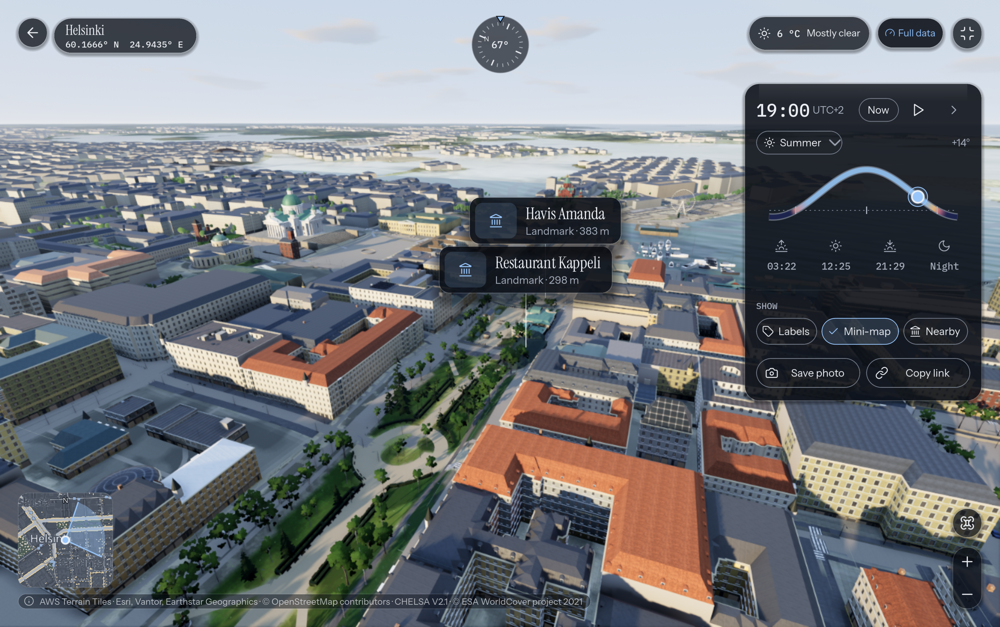

# planet-render-360

> Render any point on the map as a 3D, 360-degree view.



## Summary

Planet Render 360 is a Godot 4.7.2 mobile-first app that lets you pick any point on Earth via map tap, place search, or coordinates and generates an accurate on-device 360° 3D view of that location. It fetches real-world data from only free public sources — AWS Terrain Tiles for elevation, Esri World Imagery for satellite draping, OpenStreetMap via Overpass for buildings and roads, CHELSA for climate, Open-Meteo for weather, OpenFreeMap vector tiles and Nominatim for the map and search, and Wikipedia with Wikimedia Commons for landmark details — unified behind a shared `LocationData` contract. A staged, cancellable pipeline builds a true-metre world of far-terrain rings, DEM terrain, water and shore, extruded buildings with regional roofs and facades, recognizable landmarks, roads, and climate-driven vegetation. Rendering uses a drag-to-look 360° camera with LOD rings, a quality governor, NOAA true solar positioning, and seasonal sky and weather dressing, backed by history and built-world caching for fast revisits. Visuals aim to stay as close to reality as possible while rendering smoothly on mobile, with a polished loading flow that keeps waits to a few minutes at most.

## Core Idea and Use Case

- Pick a location by entering coordinates or selecting it on a world map.
- Procedurally generate a 360-degree view of the location, using optimized techniques suitable for mobile.
- Analyze the location so landmarks (e.g., the Eiffel Tower) are rendered recognizably — ideally generated on the fly on the device.
- Built with **Godot**, with **Blender** for offline asset preparation.

## Core Requirements

- Use only freely available APIs and data sources without strict rate limits.
- Use accurate elevation from a digital elevation model (DEM) so terrain matches the real location.
- Use accurate terrain types and visuals (e.g., [Polyhaven](https://polyhaven.com/) CC0 resources).
- Generate views on the fly over the network using free public APIs, with attribution where required — e.g., OpenFreeMap, DEM sources, and CHELSA for modeling local climate patterns, especially in complex, mountainous, or remote terrain.
- Keep loading times reasonable (a few minutes at most). Show an informative, polished loading screen that visualizes what is happening and how far loading has progressed.
- Optionally render the current time of day, season, and even current weather (e.g., rain) if time allows.

## UI and UX

- Provide intuitive controls alongside a world map for selecting locations: a turning globe, a vector map with search (/, ⌘F or Ctrl+F), featured places, and landmark markers that open a Wikipedia summary and, where one exists, a free Commons photo. The selected place shows its elevation, local time and weather; Enter explores it.
- Keep a history of recently viewed places, with favourites.
- Cache built worlds and fetched areas for faster repeat views, and download a place for offline use.
- Search and select capital cities and territories from the bundled GeoNames catalog. The original featured places and some capitals include bundled OSM snapshots. Other capital data needs a network connection to fetch it or to save it for offline use.
- Make the rendered 3D 360-degree view the main focus once loaded.
- Support full-screen mode with intuitive view controls.
- History and Recents show the view as you left it, and reopening a place restores where you were looking.
- In the 360 view: tap the ground or hold W A S D to walk inside the built area and E / Q to rise and come back down; fly a drone over the whole detailed area (G: W A S D fly with momentum, E / Q climb up to 500 m over the ground, Shift speeds up, on-screen sticks on touch screens); play the day as a time-lapse (T) or pick any calendar date for the sun's path; name the peaks, towns and lakes on the skyline (N); show a mini-map with the view cone (M); save a photo (P), save a 360° photo you can look around in (O; a JPEG with panorama metadata, for photo viewers and social sites), or copy a link to the exact view (C) and paste it into search to reopen it; list the landmarks nearby (L).
- Viewer keys: arrows look (Shift for bigger steps), + / − zoom, [ ] move the time by 15 minutes (Shift: an hour), 1–4 pick the season, H hides the HUD, F toggles full screen, I shows or hides the controls sheet, Esc closes an open panel and otherwise steps back to the map (⌘Q / Ctrl+Q quits).
- When live data does not arrive, the view says so in plain words and shows what it uses instead.
- Settings: Night, Day or system theme, an accent that can follow the sun, Reduce motion, Solid panels and Increase contrast, layout, units, cache size, and render quality (Fast / Balanced / High / Ultra).

To refresh the capital catalog, download `countryInfo.txt` and `cities1000.zip`
from [GeoNames](https://download.geonames.org/export/dump/) and run
`python3 tools/generate_capitals.py countryInfo.txt cities1000.zip scripts/data/capital_catalog.gd`. GeoNames
data is licensed under CC BY 4.0. Saving a place offline also prepares its
detailed, surrounding, far-city and POI OSM layers; a partial save is reported
if any layer cannot be downloaded or retained in the cache. The app retries
failed data during the save when time permits; select the partial-save control
to try again later using the data already cached.

Capital OSM snapshots can be prepared from GeoFabrik extracts with
`tools/export_capital_points.gd`, `tools/plan_capital_extracts.py`, and
`tools/bundle_capital_region.py`. The planner requires Shapely and checks
that the source region covers a padded area around each viewpoint; the
bundler requires osmium-tool and pyosmium. It checks the source replication
timestamp and rejects incomplete or invalid layers. For example:

```sh
tools/godot_bg.sh --headless --path . --script tools/export_capital_points.gd -- /tmp/capital-points.json
curl -fsSL https://download.geofabrik.de/index-v1.json -o /tmp/geofabrik-index.json
python3 tools/plan_capital_extracts.py /tmp/capital-points.json /tmp/geofabrik-index.json /tmp/capital-plan.json
# Download the region PBF named in the plan, then:
python3 tools/bundle_capital_region.py /tmp/capital-plan.json REGION /path/to/region.osm.pbf
tools/godot_bg.sh --headless --path . --script tests/capital_snapshot_test.gd
```

Where one GeoFabrik region would be a country- or continent-sized download,
`tools/bundle_capital_union.py` merges synchronized neighbouring regions, and
`tools/bundle_capital_external.py` prepares BBBike city extracts, OpenStreetMap
France extract pairs, OSM map API responses for small islands, and GeoFabrik
extracts with one supplementary OSM relation. For example:

```sh
python3 tools/bundle_capital_external.py /tmp/capital-plan.json capital_no_14991273_19074609 --workdir /tmp/capital-sources bbbike Oslo
python3 tools/bundle_capital_external.py /tmp/capital-plan.json capital_pm_13677914_12382270 --workdir /tmp/capital-sources \
  osmfr --extract north-america/saint_pierre_et_miquelon --extract north-america/canada/newfoundland_and_labrador
```

The source used for each capital is recorded in its provenance entry. Pass
`--include-bundled` to the planner to refresh capitals that already have snapshots.

The capital audit requires every preset by default. During an incremental
regeneration, pass `-- --allow-missing` to validate only the snapshots already
prepared.

Snapshots are only published after all five layers validate. Provenance and
query versions are recorded in `assets/osm_snapshots/capital_provenance.json`;
the catalog audit lists locations that still need snapshots.
For a batch, add `--continental` to the planner and use
`python3 tools/bundle_capital_plan.py /tmp/capital-plan.json --workdir /tmp/capital-sources`.
The continental sources total tens of gigabytes; the batch checks for free
space, processes one source at a time, safely resumes an unchanged interrupted
download with bounded-range retries, verifies the published source checksum,
and removes its own completed downloads. `--batch-size 2` extracts two views
per scan to reduce processing time, at the cost of additional memory.

### Capital bridges

The major bridges of the capitals are rows in `scripts/data/bridges/bridge_specs_*.gd`
(schema and rules in `scripts/data/bridges/bridge_spec.gd`): real span, width,
deck height, tower or arch height and bearing, each with its source and a
confidence. `BridgeParam` builds a model from a row, and `LandmarkSites` shows
the nearest few per quality preset beside the city's own landmarks. A row
below confidence 2 stays in the table but is not built, so the mapped deck is
drawn instead of a guess. `python3 -I tools/bridge_candidates.py <snapshot>`
measures the named bridges in a bundled snapshot (centre, bearing, length) to
seed new rows; `tests/bridge_specs_test.gd` checks every row.

## Platforms

Initial development targets **macOS** for easier development and testing, followed by **iOS** and **Android**.

### Building releases

Release builds run from GitHub Actions on demand: **Actions → Build → Run workflow**
([`.github/workflows/build.yml`](.github/workflows/build.yml)). Inputs:

- `platform`: `both`, `macos` or `ios`
- `macos_signing`: `adhoc` (no secrets needed) or `notarized` (Developer ID signed, notarized, stapled)
- `version`: the marketing version, e.g. `0.1.0`; the build number is the workflow run number
- `testflight`: upload the iOS build to TestFlight, or attach the `.ipa` to the run instead

Android builds run from **Actions → Android → Run workflow**
([`.github/workflows/android.yml`](.github/workflows/android.yml)) with
`version` and `build_type` (`release` or `debug`) inputs; the `.apk` is
attached to the run as an artifact.

The macOS `.dmg` is attached to the run as an artifact. Secrets live in the `release`
environment and are never committed:

| Secret | Used for |
| --- | --- |
| `APPLE_TEAM_ID` | iOS signing |
| `ASC_KEY_ID`, `ASC_ISSUER_ID`, `ASC_KEY_P8_BASE64` | App Store Connect API key (Admin role): iOS automatic signing, TestFlight upload, macOS notarization |
| `MACOS_SIGN_IDENTITY` | e.g. `Developer ID Application: Name (TEAMID)` |
| `MACOS_CERT_P12_BASE64`, `MACOS_CERT_PASSWORD` | the Developer ID certificate exported as `.p12` (`base64 -i cert.p12`) |
| `ANDROID_KEYSTORE_BASE64`, `ANDROID_KEYSTORE_PASSWORD`, `ANDROID_KEY_ALIAS` | Android release keystore (`base64 -i release.keystore`); without them a `release` run fails, and only the `debug` build type (a throwaway debug key) can be built. The `.apk` is sideload/direct distribution only — Google Play requires an `.aab`, which the workflow does not produce |

The first TestFlight upload also needs an App Store Connect app record for
`com.planetrender360.app`. The same scripts run locally:

```sh
tools/build_macos.sh               # ../build/macos/PlanetRender360.dmg (ad-hoc; set MACOS_SIGN_IDENTITY + ASC_* to notarize)
IOS_UPLOAD=0 tools/build_ios_release.sh  # ../build/ios/export/*.ipa (needs APPLE_TEAM_ID + ASC_*)
tools/build_android.sh             # ../build/android/PlanetRender360.apk (needs JDK 17 + Android SDK; set ANDROID_KEYSTORE_* to release-sign)
```

An ad-hoc macOS build opens on other Macs after `xattr -dr com.apple.quarantine "Planet Render 360.app"`.
Exported builds keep their data in `~/Library/Application Support/Planet Render 360/`.

## Development

Stack: Godot 4.7.2 (standard, non-.NET build) + GDScript, Blender offline
for assets, GDAL for dev-time geo data prep. No Flutter, no self-hosted
server, free with no paywall. Architecture:
[`.agents/plans/2026-10-27-planet-render-360-architecture.md`](.agents/plans/2026-10-27-planet-render-360-architecture.md),
data-source gate: [`docs/data-source-register.md`](docs/data-source-register.md).

The bundled world map (`assets/map/*.tilepack`, about 200 MB) is stored in
Git LFS: run `git lfs install` once before cloning, or `git lfs pull` in an
existing clone, otherwise those files are pointers and the zoomed-out map
streams instead. Rebuild it with `tools/build_map_pack.sh`.

Run: open the project in Godot 4.7.2, or from the repo root:

```sh
godot --path .            # run the app
godot --headless --script tests/smoke_test.gd   # contract checks
godot --headless --script tests/class_registry_test.gd # no global class_name outside scripts/
godot --headless --script tests/shutdown_guard_test.gd # threads and network handles tear down on quit
godot --headless --script tests/leak_test.gd    # no orphan nodes in any picker layout
godot --headless --script tests/osm_test.gd     # OSM parser (offline fixture)
godot --headless --script tests/osm_fallback_test.gd # Overpass fallbacks: OSM API bbox, nearby cache
godot --headless --script tests/tiles_test.gd   # tile math + pool drain
godot --headless --script tests/map_pan_test.gd # tiles follow the drag, no repeated queueing
godot --headless --script tests/map_pack_test.gd # bundled map packs: round trip, full coverage, fetchers
godot --headless --script tests/progressive_map_test.gd # progressive map: preview first, detail centre-out
godot --headless --script tests/vector_map_test.gd # vector map: MVT decode, Map style rules, tile build
godot --headless --script tests/landmark_test.gd # landmark registry, models, placement
godot --headless --script tests/landmark_fidelity_test.gd # well-mapped OSM landmarks drawn from their own parts
godot --headless --script tests/landmark_info_test.gd # landmark markers, details and visits (Wikipedia fixtures)
godot --headless --script tests/landmark_list_test.gd # 360 view's nearby-landmarks list, panel flow, L key
godot --headless --script tests/monument_test.gd # memorial columns and obelisks become landmarks
godot --headless --script tests/wheel_ground_test.gd # observation wheels + restored ground
godot --headless --script tests/preset_views_test.gd # curated preset vantages and the generic eye
godot --headless --script tests/viewer_tools_test.gd # view links, camera per place, thumbnails, photo, time-lapse, dates, horizon labels, mini-map, walking
godot --headless --script tests/drone_test.gd # drone mode: steering, roam edge, hover, sticks, readout, take-off and landing
godot --headless --script tests/user_dir_test.gd # moving data from Godot's default user directory
godot --headless --script tests/exit_tile_test.gd # exit button + stale-tile cancellation on far pans
godot --headless --script tests/search_test.gd  # place-search parser
godot --headless --script tests/weather_test.gd # weather parser
godot --headless --script tests/dem_test.gd     # live DEM decode (network once)
godot --headless --script tests/helsinki_dem_test.gd # Helsinki's keyless 1 m city DTM (WCS) decode and merge
godot --headless --script tests/host_policy_test.gd # no Russian-operated host in code, config or catalogues
godot --headless --script tests/bundled_osm_test.gd # bundled snapshots: queries, checksums, layers
godot --headless --script tests/capital_catalog_test.gd # GeoNames capital catalogue
godot --headless --script tests/capital_snapshot_test.gd # capital snapshot audit (-- --allow-missing while incomplete)
python3 -I tests/capital_snapshot_tools_test.py # capital snapshot planner and bundler tools
godot --headless --script tests/bridge_specs_test.gd # every capital bridge row: schema, sources, confidence
godot --headless --script tests/building_variety_test.gd # paint families, tints, proportions, neighbour evidence
godot --headless --script tests/road_markings_test.gd # road markings, crossings, stop lines and aprons
godot --headless --script tests/flow_test.gd    # picker -> loading -> 360 flow
godot --headless --script tests/data_notes_test.gd # degraded-data notices: loading line, card, badge
godot --headless --script tests/generation_timeout_test.gd # a place that takes too long returns to the picker
godot --headless --script tests/build_guard_test.gd # no second world build while one runs
godot --headless --script tests/loading_building_test.gd # "Building the scene" progress after the fetch
godot --headless --script tests/responsive_test.gd # breakpoints + layout switching
godot --headless --script tests/settings_test.gd # render-quality presets, persistence, FPS ceiling
godot --headless --script tests/zoom_search_test.gd # map/360 zoom, on-device search predictions, time of day
godot --headless --script tests/accent_sun_test.gd # Auto accent follows the sun
godot --headless --script tests/sky_test.gd      # sky per season, time of day and weather
godot --headless --script tests/solar_test.gd    # true sun position vs ephemeris
godot --headless --script tests/lightning_test.gd # thunderstorm lightning by weather, season, day
godot --headless --script tests/climate_test.gd  # CHELSA reader + climate model (CLIMATE_LIVE=1 for a live read)
godot --headless --script tests/world_scale_test.gd # true-metre lat/lon conversion at the golden locations
godot --headless --script tests/terrain_scale_test.gd # terrain relief at true scale, no vertical exaggeration
godot --headless --script tests/ground_index_test.gd # land-class and building grids match full scans
godot --headless --script tests/polygon_index_test.gd # banded point-in-polygon index (Venice lagoon)
godot --headless --script tests/scenery_test.gd  # building scale, terrain normals, water, landmark
godot --headless --script tests/arid_ground_test.gd # dry ground, not lawn, in arid places
godot --headless --script tests/building_fabric_test.gd # party walls, street roofs, courtyards, facade relief
godot --headless --script tests/architecture_test.gd # regional building styles by country and kind
godot --headless --script tests/facade_relief_test.gd # window recesses and roof variety
godot --headless --script tests/far_city_test.gd # far city only where the place is built up
godot --headless --script tests/lod_test.gd     # LOD rings keep every object in place at every preset
godot --headless --script tests/render_upgrade_test.gd # grade, lit windows at night, wall tints
godot --headless --script tests/parallel_build_test.gd # parallel world build matches the serial one
godot --headless --script tests/fidelity_scorecard_test.gd # golden locations vs source data (live when uncached)
godot --headless --script tests/atomic_file_test.gd # atomic writes; an unreadable history.json is kept as .bak
godot --headless --script tests/overpass_rate_limit_test.gd # 429/406 pause an Overpass instance for 30 s or Retry-After
godot --headless --script tests/remote_config_test.gd # service-address overrides: validation, defaults, cache
godot --headless --script tests/store_readiness_test.gd # privacy policy names every host, licence texts ship, config.json is inert
godot --headless --script tests/privacy_page_test.gd # Settings → Privacy says what site/privacy.html says, and builds
godot --headless --script tests/satellite_decode_test.gd # cached satellite tiles decode on workers: placement, damaged file, freed mid-decode
godot --headless --script tests/panorama_test.gd # 360° photo: file name, GPano metadata, JPEG segment, face geometry
godot --headless --script tests/snapshot_reader_test.gd # bundled snapshots load on workers: concurrent reads, cancel, replace, freed mid-read
godot --headless --script tests/quality_governor_test.gd # FPS governor holds after a step down; first preset follows the GPU
godot --script tests/screenshot_test.gd         # capture UI screenshots (phone/tablet/desktop)
godot --script tests/panorama_render_test.gd     # 360° photo projection: six coloured walls land where the viewer sees them (windowed)
godot --script tests/world_cache_test.gd        # built-world cache: save, cached revisit, eviction (windowed)
tools/check_class_size.sh                       # every class under scripts/ at or under 1000 lines
tools/run_tests.sh [name ...]                   # all headless tests (skips windowed and live-network ones); also runs on every pull request
```

On macOS, launch windowed runs through `tools/godot_bg.sh` (same arguments as
`godot`, or copy it to `~/.local/bin/godot`): it keeps the window behind your
editor and adds `--windowed` so the full-screen project setting does not take
over a Space.

Current MVP: onboarding → map home (globe, vector map, tap/search/coordinates,
landmark markers) → staged loading pipeline and parallel world build → 360°
terrain view with real DEM draped in satellite imagery, drag-look, landmarks,
buildings, vegetation, time-of-day, date and season controls, live-weather
dressing and the viewer tools (walk, time-lapse, horizon labels, mini-map,
photo, view links, nearby landmarks) → on-device history, favourites and
built-world cache. All data sources are settled in the data-source register
behind the same `LocationData` contract.

## Project Structure

```text
planet-render-360/
├── project.godot              Godot 4.7 project (Forward+ / Mobile, 390×844 mobile-first frame)
├── export_presets.cfg         macOS / iOS / Android export presets
├── scenes/
│   ├── startup.tscn           Entry scene → scripts/startup.gd; splash while the main scene loads
│   └── main.tscn              App root scene → scripts/main.gd
├── scripts/                   GDScript app code (≤1000 lines per class)
│   ├── startup.gd             Splash screen and threaded main-scene loading
│   ├── main.gd                Screen manager: Onboarding → MapPicker → Loading → View360 (+ History, Settings)
│   ├── user_dir_migration.gd  First launch from the app's own user directory: brings the old data across
│   ├── ui_theme.gd            Design-system tokens and theme (Night / Day)
│   ├── ui_prefs.gd            Appearance, accessibility, units and cache choices applied app-wide
│   ├── accent_sun.gd          Auto accent that follows the sun at the place shown
│   ├── ui_icon.gd, brand.gd   Lucide icons and the logo files from the design system
│   ├── announcer.gd           Screen-reader announcements
│   ├── hud_style.gd           Smoked-glass HUD styling for the 360 view
│   ├── responsive.gd          Phone / tablet / desktop breakpoints
│   ├── data/                  Fetch layer: one fetcher per free public source
│   │   ├── location_data.gd       LocationData — the contract between fetch, generation and render
│   │   ├── dem_fetcher.gd         AWS Terrain Tiles (Terrarium) elevation mosaics
│   │   ├── coastal_dem.gd         Sea-level correction measured from OSM coastlines
│   │   ├── far_field_fetcher.gd   Far DEM rings + imagery drapes past the detailed extent
│   │   ├── satellite_fetcher.gd   Esri World Imagery terrain drape
│   │   ├── osm_*.gd, overpass_request.gd
│   │   │                          Overpass query, fetch, parse, tags + ring geometry; OSM API and nearby-cache fallbacks
│   │   ├── far_city_fetcher.gd    One aggregated Overpass call for the far city ring
│   │   ├── bundled_osm.gd, snapshot_reader.gd, offline_osm_pack.gd
│   │   │                          Bundled OSM snapshots (assets/osm_snapshots): queries, integrity, threaded reads, offline packs
│   │   ├── capital_catalog.gd, capital_continents.gd
│   │   │                          Generated GeoNames capital/territory catalogue and its continent grouping
│   │   ├── remote_config.gd, host_policy.gd
│   │   │                          Validated service-address overrides (site/config.json) and the no-Russian-host rule
│   │   ├── ground_model*.gd, ground_tiff.gd, helsinki_dem*.gd, national_grids.gd
│   │   │                          Surface-model fetch and decode, Helsinki's keyless 1 m DTM, national grid projections
│   │   ├── climate_fetcher.gd     CHELSA V2.1 climatologies via ranged GeoTIFF reads
│   │   ├── landcover_fetcher.gd, landcover_source.gd
│   │   │                          ESA WorldCover land classes + Meta canopy-height windows
│   │   ├── cog_fetcher.gd, cog_reader.gd
│   │   │                          Bounded HTTP-range reads and Cloud Optimized GeoTIFF decoding
│   │   ├── weather_fetcher.gd     Open-Meteo current weather
│   │   ├── search_fetcher.gd      Nominatim place search
│   │   ├── vector_tile_fetcher.gd OpenFreeMap vector tiles + Terrarium hillshade for the map
│   │   ├── tile_fetcher.gd, tile_connection.gd
│   │   │                          OSM raster tiles (globe, picker fallback) over kept-alive connections
│   │   ├── map_pack.gd            Bundled map-tile packs for offline coverage
│   │   ├── wiki_fetcher.gd, wiki_parse.gd
│   │   │                          Wikipedia + Commons landmark markers, summaries and photos
│   │   ├── landmark_*.gd          Regional registries, landmark sites, OSM fidelity and visit viewpoints
│   │   ├── bridges/               Capital bridge tables (bridge_specs_*.gd by region) and the BridgeSpec schema
│   │   ├── building_references.gd, road_widths.gd, suomenlinna_site.gd
│   │   │                          Building reference dimensions, shared road widths and fortress-site data
│   │   ├── preset_views.gd        Curated opening view for each quick-pick place
│   │   ├── horizon_fetcher.gd     One Overpass call for the named peaks, towns and lakes (horizon labels)
│   │   ├── view_link.gd           Shareable view links + the camera state History keeps per place
│   │   ├── place_thumb.gd         History / Recents pictures and bundled preset thumbnails
│   │   ├── cache_store.gd         History + versioned, LRU-capped tile/area cache
│   │   └── offline_downloader.gd  "Download for offline" cache warmer
│   ├── map/                   Vector map in the design system Map style: MVT decode, style rules,
│   │                          line meshing, hillshade, labels
│   ├── generation/            World building from LocationData (true metres)
│   │   ├── pipeline.gd            Staged, cancellable fetch pipeline: elevation, imagery, buildings & landmarks, weather
│   │   ├── world_scale.gd         Unit conversions + render origin
│   │   ├── ground_truth.gd        One height / water / land-cover surface per place
│   │   ├── dem_registration.gd, dem_conversion.gd, bare_earth.gd, finland_relief.gd
│   │   │                          DEM alignment, conversion and surface-model relief correction
│   │   ├── ground_index.gd, polygon_index.gd
│   │   │                          Fast land-class, building and point-in-polygon lookups
│   │   ├── terrain_builder.gd     Assembles the world: far → terrain → water → buildings → roads → landmarks → vegetation
│   │   ├── world_build_graph.gd, build_*.gd
│   │   │                          Runs the build stages in parallel; texture prewarm, stop requests
│   │   ├── data_notes.gd          Plain-language record of live data that did not arrive
│   │   ├── far_*.gd, settlement_map.gd, infill_planner.gd
│   │   │                          Far terrain rings and the far city, only where the place is built up
│   │   ├── building_*.gd, roof_*.gd, facade_*.gd, storey_composer.gd, architecture_*.gd
│   │   │                          OSM building extrusion, regional style, roofs and facades; city and country-era style tables
│   │   ├── tower_massing.gd, neighbour_evidence.gd, wall_variety.gd, party_walls.gd
│   │   │                          Tower setbacks, evidence from neighbouring buildings, paint families, party walls
│   │   ├── road_*.gd, street_*.gd, rail_builder.gd, kerb_builder.gd, bridge_arches.gd
│   │   │                          Roads, markings, rails, kerbs, bridges and street furniture
│   │   ├── shoreline_model.gd, shore_*.gd, water_*.gd, quay_*.gd
│   │   │                          Shared shoreline geometry, water ownership, banks, quays and moorings
│   │   ├── tree_*.gd, vegetation_*.gd, canopy_vegetation.gd, foliage_textures.gd, climate_model.gd
│   │   ├── parked_cars.gd, car_models.gd, car_paint.gdshader
│   │   │                          Parked vehicle placement, imported models and paint shader
│   │   ├── ship_builder.gd, marina_builder.gd, harbour_ferries.gd, vessel_*.gd, *_model.gd
│   │   │                          Procedural vessels, marinas and harbour ferries
│   │   ├── landmark_*.gd, suomenlinna_*.gd
│   │   │                          Landmark builders, shared geometry, materials and OSM archetypes
│   │   ├── landmarks/            Landmark sets split by region, city and type (Finland, Stockholm,
│   │   │                          San Francisco, bridges, historic sites and more)
│   │   └── material_library.gd, pbr_*.gd, ground_*.gd, terrain_*.gd, mesh_arrays.gd, mass_batch.gd
│   ├── render/                Runtime rendering
│   │   ├── camera_rig.gd          Drag-to-look 360° camera
│   │   ├── atmosphere_rig.gd      Sun, sky, haze, clouds, weather
│   │   ├── sky_palette.gd, sky_shader.gd, weather_look.gd, lightning_rig.gd, marine_layer.gd
│   │   │                          Sky grade and dome shader, weather light, lightning and coastal fog
│   │   ├── post_grade.gd, city_lights.gd, roof_snow.gd
│   │   │                          Tonemap and grade, lit windows at night, snow on roofs
│   │   ├── street_lights.gd, shop_lights.gd, landmark_lights.gd
│   │   │                          Night lighting for streets, shopfronts and landmarks
│   │   ├── solar_position.gd      NOAA true solar position
│   │   ├── lod_ring.gd            Static LOD rings via visibility ranges
│   │   ├── quality_governor.gd    FPS-driven render-scale / shadow steps
│   │   ├── render_settings.gd     Fast / Balanced / High / Ultra presets
│   │   ├── render_quality.gd      Photoreal layer per tier
│   │   └── world_cache.gd         Built-world cache for fast revisits
│   └── screens/               UI screens (onboarding, map home with globe and landmark markers, loading,
│                              360 view, history, settings); the viewer's tools: view_tools, photo_mode,
│                              panorama_capture, time_lapse, date_picker, horizon_labels, mini_map, view_walk, view_drone,
│                              drone_sticks, landmark_list
├── native/                    Optional C++17 GDExtension kernels (GDScript fallbacks when unbuilt)
│   ├── CMakeLists.txt         Native build configuration
│   ├── src/                   Terrain, city, roof, mesh, shoreline, triangulation and MVT kernels
│   ├── godot-cpp/             Godot C++ bindings (Git submodule)
│   └── bin/                   Generated libraries and .gdextension manifest (tools/build_native.sh)
├── assets/                    Runtime assets
│   ├── eiffel.glb             Eiffel Tower model
│   ├── osm_snapshots/         Bundled gzip OpenStreetMap layers for the featured places and capitals
│   │                          (ODbL; provenance in capital_provenance.json and its README)
│   ├── capital_thumbs/        Capital place thumbnails
│   ├── brand/, icons/, fonts/  Brand artwork, Lucide icons and typefaces
│   ├── map/                   Bundled map-tile packs (Git LFS)
│   ├── preset_thumbs/         Curated place thumbnails
│   ├── textures/              CC0 Poly Haven PBR sets (2k/) and foliage atlases (foliage/)
│   └── vehicles/              Imported car models, textures and attribution
├── assets_src/blender/        Blender sources (offline only, never shipped)
├── tests/                     About 150 regression scripts and offline fixtures/ (mostly headless;
│                              screenshot_test.gd, panorama_render_test.gd and world_cache_test.gd need a window)
├── tools/                     Release, native and map-pack builds; Godot background launcher and
│                              no-activation shim; test and class-size runners; capital catalogue and
│                              OSM snapshot planners and bundlers (Python); bridge candidates, benchmarks,
│                              captures, landmark audits, comparison sheets, foliage generation and documentation PDF build
├── .github/
│   ├── actions/               Godot setup for macOS and Linux CI runners
│   └── workflows/             Tests on every pull request, GitHub Pages, and on-demand macOS .dmg,
│                              iOS TestFlight / .ipa and Android .apk builds
├── site/                      Project page, privacy policy and config.json, published to GitHub Pages
├── licenses/                  Font and icon licence texts shipped inside the app
├── docs/                      Data-source register, world-model contract, fidelity scorecard,
│                              architecture styles, landmark sources, technical documentation and images
├── .agents/plans/             Architecture, fidelity, city realism, build speed, shoreline and city-hero plans
├── visual-plan/               PRD, reference photos, baseline / best snapshots, captures and review scorecards
└── generated_images/          Logo explorations, prototypes and screenshots
```

## Documentation

- [Technical documentation (PDF)](docs/technical-documentation.pdf) — architecture,
  data flow, pipeline, world model, rendering and caching, with diagrams.
  Source: [`docs/technical-documentation.html`](docs/technical-documentation.html),
  rebuilt with `node tools/build_docs_pdf.js`.
- [World-model contract](docs/world-model-contract.md) — `LocationData`, `GroundTruth`, builder signatures.
- [Data-source register](docs/data-source-register.md) — every external source, licence and fallback.
- [Fidelity scorecard](docs/fidelity-scorecard.md) — checks that prove the contract holds.
- [Architecture styles](docs/architecture-styles.md) — regional building styles.
- [Remote config](docs/remote-config.md) — switching service addresses without an app update.
- [Store readiness](docs/store-readiness.md) — what the app stores need, draft declarations and open decisions.

## License

Distributed under the MIT License. See [LICENSE](LICENSE) for details. Bundled data,
fonts, icons, textures and models keep their own licences: see [NOTICE.md](NOTICE.md).
